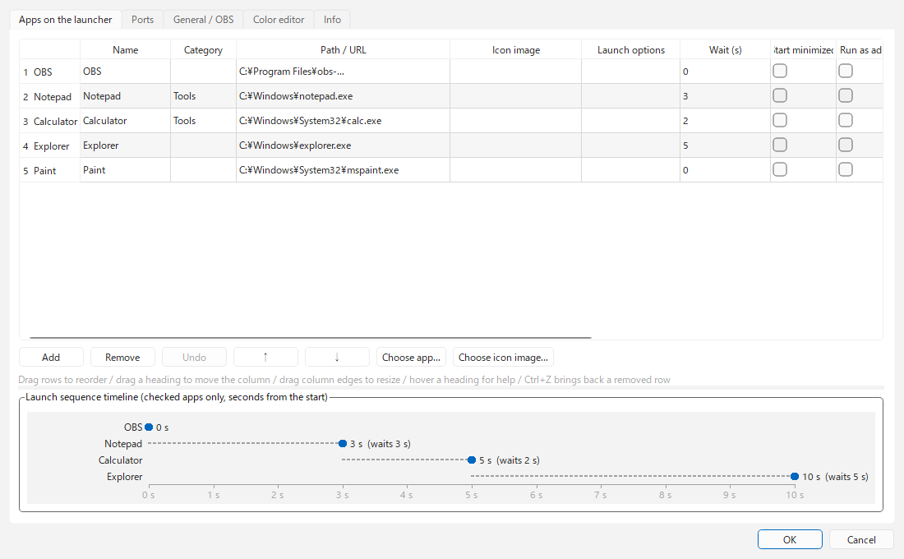
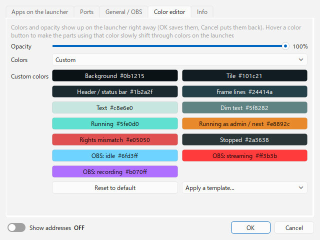
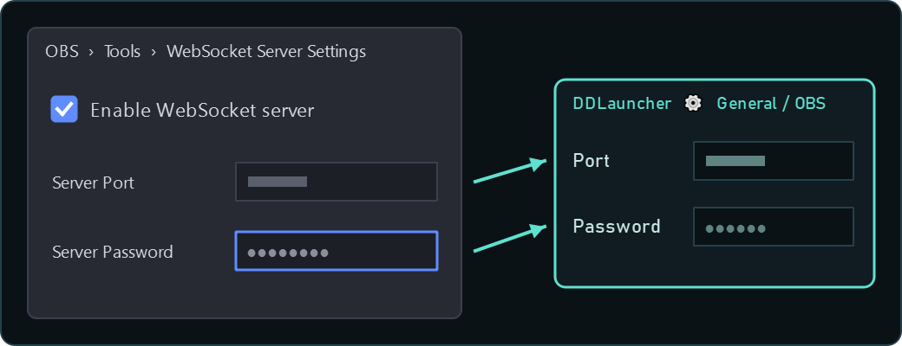
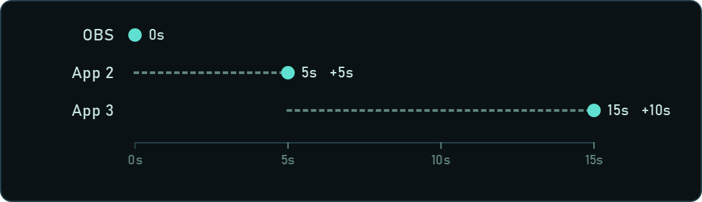
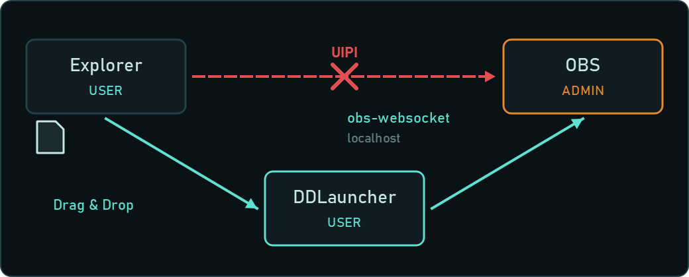
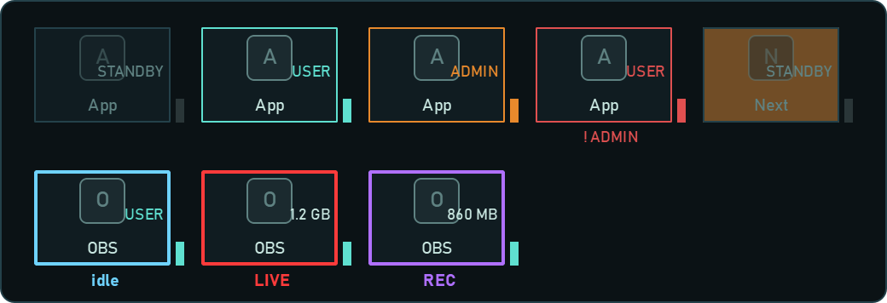
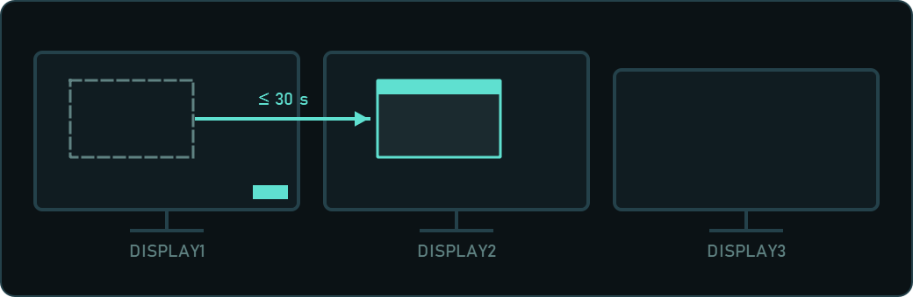
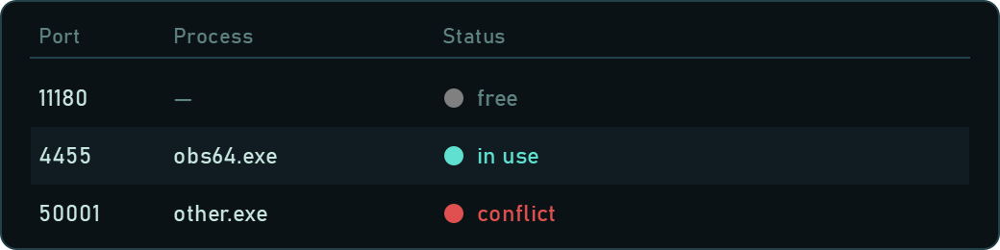
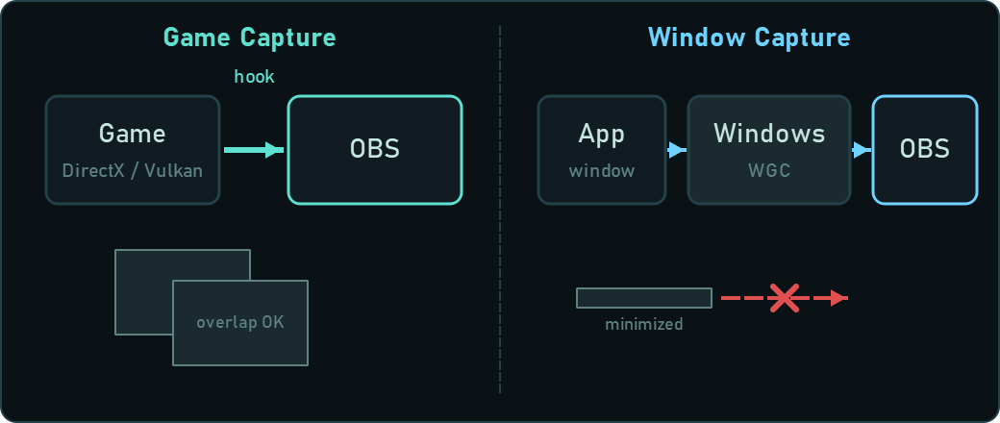

# DDLauncher

[English](README.md) | [日本語](README.ja.md) | [한국어](README.ko.md) | [Bahasa Indonesia](README.id.md) | **Français** | [繁體中文](README.zh-TW.md)

Un lanceur léger pour streamers, qui reste discrètement dans un coin de l'écran (Windows).

> [!TIP]
> **Ajoutez des sources à OBS par glisser-déposer, même quand OBS tourne en administrateur.**
> D'habitude, quand OBS tourne en administrateur, Windows bloque le glisser-déposer depuis l'Explorateur. DDLauncher reçoit les fichiers déposés sur le lanceur et les transmet à OBS via obs-websocket : cette restriction ne s'applique donc pas.

- Lance OBS et vos autres applis dans l'ordre choisi, avec un délai entre chacune. Une appli déjà lancée ne l'est pas deux fois.
- Un voyant de couleur indique si chaque appli tourne, et si elle tourne en administrateur.
- En temps normal, seule une petite icône reste dans le coin ; le lanceur ne s'ouvre qu'au survol.

<p>


</p>


## Configuration requise

- Windows 10 / 11
- OBS Studio 28 ou plus récent (les versions qui intègrent obs-websocket 5)
- Langues de l'interface : English / 日本語 / 한국어 / Bahasa Indonesia / Français / 繁體中文

## Téléchargement et installation

Téléchargez l'une des deux versions dans [Releases](https://github.com/ChromeBread/DDLauncher/releases/latest).

| Version | Fichier | Pour qui |
|---|---|---|
| Installateur | `DDLauncher-0.3.0-windows-x64-setup.exe` | Une entrée dans le menu Démarrer, et la désinstallation depuis « Applications » de Windows |
| Autonome | `DDLauncher-0.3.0-windows-x64-portable.zip` | Sans installation. Supprimez le dossier pour l'enlever |

- Version autonome : décompressez-la où vous voulez et lancez `DDLauncher.exe`.
- L'exe n'est pas signé : au premier lancement, Windows SmartScreen (« Windows a protégé votre ordinateur ») ou votre antivirus peut afficher un avertissement. Cliquez sur « Informations complémentaires » → « Exécuter quand même ». Pour vérifier d'abord, lancez-le depuis les sources (voir « Pour les développeurs » plus bas).
- Les deux versions enregistrent les réglages dans `%APPDATA%\CBApps\DDLauncher\`.

## Préparer OBS

1. Dans OBS, ouvrez « Outils » → « Paramètres du serveur WebSocket » et cochez « Activer le serveur WebSocket ».
2. Notez le port et le mot de passe, puis saisissez-les dans le lanceur sous ⚙ → « Général / OBS ».

<p></p>

## Utilisation

### Les bases

- **Clic gauche sur une icône** : lance l'appli (rien ne se passe si elle tourne déjà). **Clic droit** : choisir de lancer avec ou sans droits d'administrateur.
- **Bloqué pendant OBS** (par appli, activé par défaut) : tant qu’OBS est lancé, cliquer sur une icône n’ouvre ni l’appli ni la page, pour qu’un clic par erreur n’apparaisse pas en live. Le menu du clic droit de l’icône permet quand même de l’ouvrir. Désactivez-le par appli dans ⚙ → « Applis du lanceur ».
- **Clic droit sur une zone vide du lanceur** : menu avec la position (4 coins), la séquence de lancement, le mode D&D, toujours déplié, au premier plan (lanceur / zone D&D, chacun séparément), les paramètres et quitter.
- **Boutons de l'en-tête** : `▲▼` faire tourner l'ordre / `D&D` activer le mode D&D / `▶` démarrer ou arrêter la séquence (si activé dans les paramètres) / `⚙` paramètres / `?` aide
- **Icône de la zone de notification** : un clic affiche le lanceur. Clic droit pour démarrer la séquence ou quitter.
- **Fenêtres de paramètres / d'aide** : s'ouvrent là où elles ne cachent pas le lanceur (l'espace libre au-dessus, en dessous, à gauche ou à droite).

### Affichage

- **Affichage normal** (⚙ → « Général », ou « Toujours déplié » dans le menu du clic droit)
  - **Icône seule** (par défaut) : seule l'icône `DD` reste dans le coin. Survolez-la (ou cliquez dessus) pour ouvrir tout le lanceur ; il redevient une icône 0,8 seconde après le départ de la souris.
  - **Toujours déplié** : reste ouvert quelle que soit la position de la souris.
  - En mode D&D et pendant la séquence, il reste ouvert dans tous les cas (pour montrer la zone de dépôt et le compte à rebours).
- **Disposition** (⚙ → « Général »)
  - **GROUP** : une colonne partant du coin. Avec « GROUP : max. en hauteur », les suivantes commencent une nouvelle colonne vers l'intérieur ; « GROUP : max. en largeur » limite le nombre de colonnes (elles s'allongent alors). 0 = illimité (une seule colonne).
  - La molette (ou ▲▼) fait tourner l'ordre comme un anneau. Activez « Ordre tourné » pour le conserver.
- **Catégorie** : les applis d'une même catégorie s'empilent dans un seul emplacement, et les autres s'ouvrent sur le côté vers l'intérieur de l'écran au survol (par ex. YouTube → Twitch → Kick dans une catégorie « Plateformes »). Maj+molette (ou l'inclinaison de la molette) sur la tuile empilée, ou les boutons ◀▶ de la rangée ouverte, changent l'appli mise en avant.
- **Taille** : **Ctrl+molette** sur le lanceur, ou « Taille » sous ⚙ → « Général », de 50 à 250 %. S'il ne tient plus à l'écran, il se réduit automatiquement.
- **Icône repliée** : par défaut l'icône `DD`. Sous ⚙ → « Général », vous pouvez afficher à la place l'icône d'une de vos applis ou pages web.
- **Rotation à la molette** : désactivez-la sous ⚙ → « Général » si la molette déplace les icônes sans le vouloir. ▲▼ et Ctrl+molette restent utilisables.
- **Langue** : à choisir sous ⚙ → « Infos » → « Language ». Par défaut, « Auto » suit la langue de l'interface d'OBS (ou celle de Windows si les réglages d'OBS sont introuvables). Les langues non prises en charge s'affichent en English.

### Séquence de lancement

<p></p>

- Lance les applis dans l'ordre des paramètres, chacune « délai en secondes après le lancement de la précédente ». La tuile de la prochaine appli clignote en orange, avec `NEXT ▸ nom secondes` en dessous.
- Placez les DAW et outils VB-Audio en dernier avec un délai plus long pour éviter qu'ils se disputent les périphériques audio.
- **Après la séquence** : « Ne rien faire / Réduire dans la barre des tâches / Masquer ». S'applique une fois toutes les applis lancées (attente jusqu'à 60 secondes). En cas d'échec ou d'appli non lancée, le lanceur reste visible.
- **Bouton ▶** : masqué par défaut. Affichez-le avec ⚙ → « Bouton de séquence ». Même masqué, la séquence se lance depuis le menu du clic droit ou la zone de notification.
- **Démarrage** : activez ⚙ → « Démarrage » pour lancer le lanceur à l'ouverture de session Windows et exécuter aussitôt la séquence.

### Mode D&D

<p></p>

Quand OBS tourne en administrateur, les fichiers déposés depuis l’Explorateur ne lui parviennent pas. DDLauncher, lancé avec des droits normaux, les reçoit et les transmet à OBS via obs-websocket : l’ajout fonctionne quand même.

- Déposez des images, vidéos ou fichiers audio sur l’espace D&D (ou sur le lanceur) pour les ajouter comme sources à la scène OBS choisie (la scène de programme actuelle si le champ est vide). Le dépôt sur le lanceur se désactive avec ⚙ → « Dépôt sur le lanceur ». Si vous déposez beaucoup de fichiers d’un coup (5 ou plus par défaut), il demande avant de les ajouter ; changez ce nombre avec ⚙ → « Confirmer les dépôts multiples ». Activez ⚙ → « Dossiers / fichiers mélangés » pour déposer des dossiers entiers et choisir les types à ajouter (images, vidéos, audio), ainsi que les extensions de chaque type. ⚙ → « Sources ajoutées par D&D » règle l’état des nouvelles sources : affichées ou masquées, en lecture ou à l’arrêt (ou seul le premier fichier en lecture), volume, sourdine, boucle, monitoring audio, ajustement à l’écran et nom de la source. Si un nom est déjà utilisé dans OBS, un numéro est ajouté automatiquement, ou il peut vous demander quoi faire (numéro, renommer, placer la source existante ou ignorer).
  - « Ajuster à l’écran » et **[Image Resize Reader for OBS](https://github.com/ChromeBread/Image-Resize-Reader-for-OBS/blob/main/README.fr.md)** (un script OBS du même développeur, qui ajuste les images et vidéos au canevas dès leur ajout) : si vous l’utilisez, laissez « Ajuster à l’écran » désactivé. Il ajuste aussi les sources ajoutées par DDLauncher, et avec les deux actifs la source se retrouve décalée ou coupée.
- En mode D&D, le lanceur ignore la marge et se colle au bord de l'écran, pour qu'un fichier ne tombe pas dans le vide et n'atterrisse pas dans une autre fenêtre. Désactivez-le avec ⚙ → « Position en mode D&D ».
- La zone D&D s’ouvre juste à côté du lanceur, collée sans jamais le recouvrir. Faites glisser un coin rayé pour changer sa taille, ou n’importe quel autre endroit pour la déplacer (⚙ → « Redimensionner l'espace D&D » permet aussi de la redimensionner par les bords). Taille et position sont mémorisées ; déposée sur le lanceur, la zone glisse contre le bord du lanceur le plus proche. Un clic droit permet de rétablir la taille ou de la remettre à côté du lanceur. Si vous la perdez de vue, utilisez « Remettre l'espace D&D à côté du lanceur (taille par défaut) » dans ⚙.

### Lire l'affichage

<p></p>

- **En haut à droite d'une tuile** : `ADMIN` = lancé en administrateur, `USER` = lancé avec les droits normaux, `STANDBY` = arrêté, `NO PATH` = chemin non défini
- **Couleurs du voyant** : gris = arrêté, vert = en cours (droits normaux), orange = en cours (administrateur), rouge = réglé en admin mais lancé avec les droits normaux
- **Cadre de la tuile OBS** : bleu clair = pas de diffusion, rouge = en direct, violet = enregistrement seul. En direct / en enregistrement, la quantité de données envoyées s'affiche en bas à droite de l'icône. L'état reste visible même fenêtre OBS fermée.

### Paramètres

- **Applis du lanceur** : glissez les lignes (ou utilisez ↑↓) pour les réordonner. Survolez un en-tête de colonne pour son explication.
  - « + Ajouter une appli… » choisit un exe ou un raccourci et remplit le nom et le chemin. « + Ajouter une adresse web » ajoute une ligne pour une URL ; la colonne « Navigateur » choisit le navigateur qui l'ouvre (le navigateur par défaut si vous n'y touchez pas). Les noms des tuiles s'affichent en majuscules ; pour les afficher tels que saisis, décochez ⚙ → « Casse des noms ».
  - Si « Image d'icône » est vide, l'icône de l'exe est utilisée, ou celle du site quand le chemin est une URL. Mettez une adresse web dans « Image d'icône » pour utiliser l'icône de ce site (ou l'image elle-même, pour l'adresse d'une image).
  - Une ligne supprimée revient avec ↶ (Ctrl+Z). La chronologie sous le tableau montre combien de secondes après le début chaque appli se lance.
  - « Écran de destination » déplace la fenêtre de l'appli vers cet écran après le lancement. Les applis lancées en administrateur ne peuvent pas être déplacées à cause d'une restriction de Windows.<br>
    
- **Ports** : enregistrez vos ports pour voir s'ils sont libres, utilisés ou en conflit (utilisés par un processus inattendu, ou enregistrés deux fois). « Libérer » ferme le processus qui utilise ce port (après confirmation). « Détecter » ajoute les ports utilisés par vos applis (OBS depuis ses paramètres WebSocket, les autres quand elles tournent). Certains lecteurs de commentaires et logiciels de synthèse vocale courants chez les streamers sont lus dans leurs fichiers de réglages, donc trouvés même fermés. Vous choisissez les ports à ajouter, et un avertissement s’affiche si deux applis reliées ne sont pas d’accord sur un port.<br>
  
- **Éditeur de couleurs** : opacité, couleurs (par défaut / personnalisées) et six modèles. Les changements s'appliquent tout de suite au lanceur, et Annuler les rétablit.
- **Infos** : langue de l'interface, version, date de compilation, nom du développeur et interrupteur Debug Mode.
  - **Debug Mode** : export / import des paramètres, entre autres.

## Désinstallation

- **Version installateur** : désinstallez DDLauncher depuis Paramètres Windows → Applications. Il vous demande d'abord si vous voulez utiliser le désinstallateur sûr pour exporter ou supprimer vos réglages.
- **Version autonome** : pour supprimer aussi les réglages, lancez d'abord `DDLauncher-Uninstall.exe`, puis supprimez le dossier.
- **Désinstallateur sûr** (`DDLauncher-Uninstall.exe`) : exportez d'abord vos réglages, vérifiez ce qu'il a trouvé (le dossier des réglages, les fichiers `DDLauncher*.exe` y compris les anciennes versions, et l'entrée de démarrage de Windows), puis déplacez seulement les éléments cochés vers la Corbeille. Les fichiers sans rapport avec DDLauncher ne sont jamais listés. Le dossier partagé `%APPDATA%\CBApps\` n'est supprimé que s'il est vide.

## Remarques

- Les paramètres sont enregistrés dans `%APPDATA%\CBApps\DDLauncher\`. S'il existe des paramètres dans l'ancien emplacement `%APPDATA%\DDLauncher\`, ils sont copiés automatiquement au premier lancement. L'ancien dossier est conservé : une version précédente continue donc de fonctionner avec (les changements faits après la copie ne s'y reportent pas).
- Les applis réglées en admin affichent une confirmation UAC à chaque lancement (au démarrage de Windows aussi).
- Certaines applis ignorent « Lancer réduit ». Pour OBS, mettre `--minimize-to-tray` dans « Options de lancement » est plus fiable.
- L'aide intégrée (`?`) détaille les avantages et inconvénients du mode administrateur, pourquoi le glisser-déposer ne marche plus, et comment régler les écrans noirs.

<p></p>

## Licence

GPL-3.0 ([LICENSE](LICENSE)). Les licences des bibliothèques incluses (PySide6 / Qt, obsws-python, etc.) sont dans [THIRD-PARTY-LICENSES.txt](THIRD-PARTY-LICENSES.txt).

## Pour les développeurs

### Lancer depuis les sources

```powershell
py -m venv .venv
.venv\Scripts\pip install -r requirements.txt
.venv\Scripts\pythonw main.py
```

Pour créer la version dossier (`dist\DDLauncher\`) et l'installateur (l'installateur nécessite Inno Setup 6) :

```powershell
.venv\Scripts\pip install pyinstaller
.venv\Scripts\pyinstaller DDLauncher.spec
iscc /DAppVersion=0.3.0 installer\DDLauncher.iss
```

### Fichiers

| Fichier | Rôle |
|---|---|
| `main.py` | Point d'entrée. Garde les paramètres et crée / recrée les fenêtres du lanceur. Vérifie l'état des applis toutes les 2 secondes, en une seule passe. |
| `launcher_window.py` | La fenêtre d'un lanceur (placement dans le coin, tuiles, repli / dépliage, mode D&D, menus) |
| `sequencer.py` | Séquence de lancement (ordre, délais, pas de double lancement) |
| `winproc.py` | Code propre à Windows (lancement normal / admin, détection des processus élevés, inscription au démarrage, ports) |
| `obs_bridge.py` | Ajout de sources et lecture de l'état de diffusion via obs-websocket 5 (sur un thread séparé, pour ne jamais figer l'interface) |
| `config.py` | Lecture / écriture des paramètres (valeurs par défaut, enregistrement résistant aux coupures, migration depuis l'ancien emplacement) |
| `i18n.py` / `locales/` | Langue de l'interface. Textes dans `locales/<langue>.json`, aide dans `locales/help/<langue>.html` |
| `about.py` | Date de compilation (écrite dans l'exe par `DDLauncher.spec`) et format de date de chaque langue |
| `theme.py` / `settings_dialog.py` | Apparence, fenêtre des paramètres |
| `uninstaller.py` | Désinstalleur sûr (`DDLauncher-Uninstall.exe`) |
| `startup_items.py` | Lecture et modification des entrées de démarrage de Windows (Run du Registre et dossier Démarrage ; sauvegarde avant modification) |

- **Séparation des droits** : le lanceur tourne avec les droits normaux. Il reçoit les dépôts de l'Explorateur et transmet les chemins des fichiers à OBS (lancé en administrateur) via le WebSocket local. Le trafic WebSocket n'est pas limité par l'UIPI : il passe malgré la différence de droits.
- **Plusieurs lanceurs** : `launchers` dans le fichier de paramètres est un tableau. Chaque élément crée une fenêtre (ajoutez-les en modifiant le JSON directement).

Tests :

```powershell
.venv\Scripts\python tests\test_core.py
```
