# DDLauncher

[English](README.md) | [日本語](README.ja.md) | [한국어](README.ko.md) | **Bahasa Indonesia** | [Français](README.fr.md) | [繁體中文](README.zh-TW.md)

Launcher ringan untuk streamer yang selalu standby di pojok layar (Windows).

> [!TIP]
> **Tambahkan source ke OBS dengan drag & drop file, bahkan saat OBS berjalan sebagai administrator.**
> Biasanya, kalau OBS berjalan sebagai administrator, Windows memblokir drag & drop dari Explorer. DDLauncher menerima file yang kamu jatuhkan ke launcher lalu meneruskannya ke OBS lewat obs-websocket, jadi pembatasan ini tidak berlaku.

- Menjalankan OBS dan aplikasi lain secara otomatis sesuai urutan yang ditentukan, dengan jeda di antaranya. Aplikasi yang sudah berjalan tidak dijalankan dua kali.
- Warna lampu menunjukkan apakah setiap aplikasi sedang berjalan, dan apakah berjalan sebagai administrator.
- Biasanya hanya menampilkan satu ikon kecil di pojok, dan baru terbuka saat kursor diarahkan ke sana.

<p>

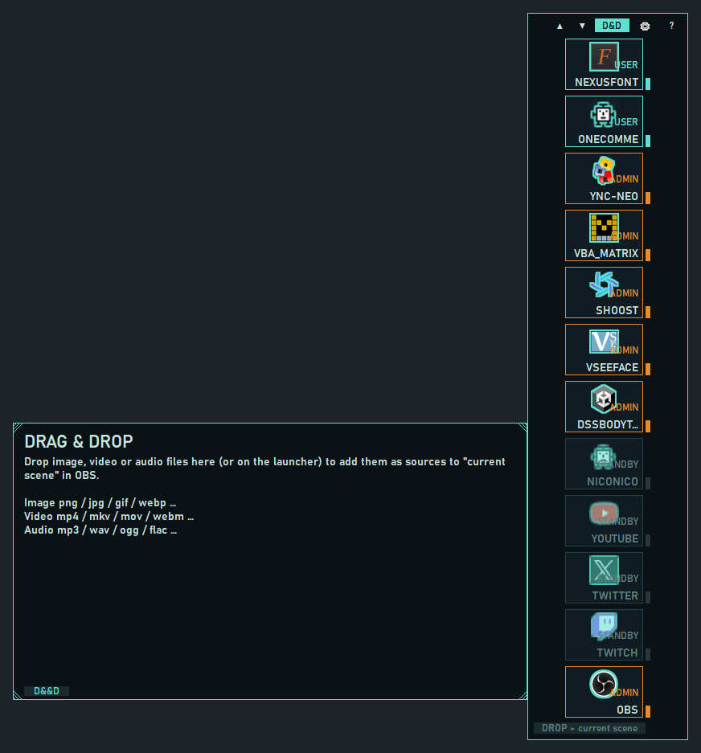
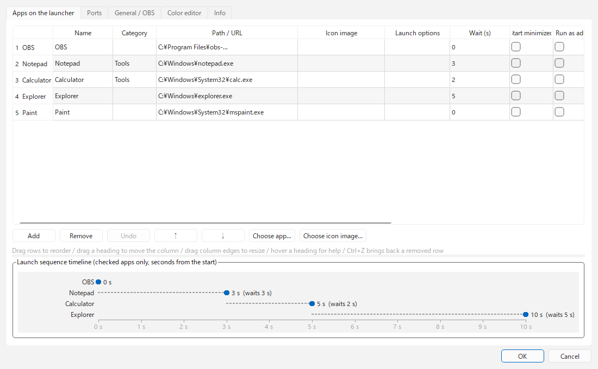
</p>

## Kebutuhan sistem

- Windows 10 / 11
- OBS Studio 28 atau lebih baru (versi yang sudah berisi obs-websocket 5)
- Bahasa tampilan: English / 日本語 / 한국어 / Bahasa Indonesia / Français / 繁體中文

## Unduh dan pasang

Unduh salah satu dari [Releases](https://github.com/ChromeBread/DDLauncher/releases/latest).

| Versi | File | Cocok untuk |
|---|---|---|
| Installer | `DDLauncher-1.0.0-windows-x64-setup.exe` | Masuk ke menu Start, dan bisa dihapus dari "Aplikasi" di Windows |
| Standalone | `DDLauncher-1.0.0-windows-x64-portable.zip` | Tanpa instalasi. Hapus foldernya untuk mencopot |

- Standalone: ekstrak di mana saja lalu jalankan `DDLauncher.exe`.
- Exe-nya tidak bertanda tangan, jadi saat pertama dijalankan Windows SmartScreen ("Windows melindungi PC Anda") atau antivirus bisa memberi peringatan. Klik "Info selengkapnya" → "Tetap jalankan". Jika ingin memeriksa dulu, jalankan dari kode sumber (lihat "Untuk developer" di bawah).
- Kedua versi menyimpan pengaturan di `%APPDATA%\CBApps\DDLauncher\`.

## Persiapan di OBS

1. Di OBS, buka "Tools" → "WebSocket Server Settings" lalu aktifkan "Enable WebSocket server".
2. Catat port dan kata sandinya, lalu masukkan di launcher pada ⚙ → "Umum / OBS".

<p>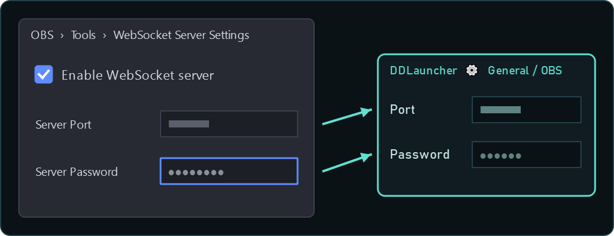</p>

## Cara pakai

### Dasar

- **Klik kiri ikon**: menjalankan aplikasi (tidak melakukan apa-apa jika sudah berjalan). **Klik kanan**: pilih jalankan sebagai administrator atau dengan hak akses normal.
- **Kunci saat OBS aktif** (per aplikasi, aktif secara bawaan): selama OBS berjalan, mengklik ikon tidak membuka aplikasi atau halaman, agar salah klik tidak terlihat di siaran. Menu klik kanan ikon tetap bisa membukanya. Matikan per aplikasi di ⚙ → "Aplikasi di launcher".
- **Klik kanan area kosong launcher**: membuka menu posisi (4 pojok), urutan peluncuran, mode D&D, selalu terbuka, selalu di atas (launcher / ruang D&D, masing-masing), pengaturan, dan keluar.
- **Tombol di header**: `▲▼` memutar urutan / `D&D` ganti mode D&D / `▶` mulai atau hentikan urutan (jika ditampilkan di pengaturan) / `⚙` pengaturan / `?` bantuan
- **Ikon tray**: klik untuk menampilkan launcher. Klik kanan untuk memulai urutan atau keluar.
- **Jendela pengaturan / bantuan**: terbuka di posisi yang tidak menutupi launcher (ruang kosong di atas, bawah, kiri, atau kanan).

<p>
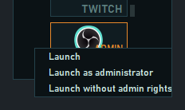
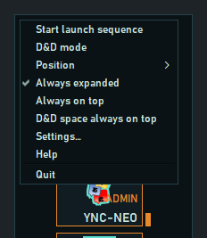
</p>

### Tampilan

- **Tampilan normal** (⚙ → "Umum", atau "Selalu terbuka" di menu klik kanan)
  - **Hanya ikon** (bawaan): hanya ikon `DD` yang ada di pojok. Arahkan kursor (atau klik) untuk membuka seluruh launcher; kembali menjadi ikon 0,8 detik setelah kursor menjauh.
  - **Selalu terbuka**: tetap terbuka tanpa memedulikan kursor.
  - Dalam mode D&D dan selama urutan peluncuran, launcher tetap terbuka apa pun pengaturannya (untuk menampilkan tempat drop dan hitung mundur).
- **Mode tampilan** (⚙ → "Umum")
  - **GROUP**: kolom dari pojok. Jika "GROUP: batas menurun" diisi, sisanya membuat kolom baru ke arah dalam; "GROUP: batas mendatar" membatasi jumlah kolom (kolom akan memanjang). 0 = tanpa batas (satu kolom).
  - Roda mouse (atau ▲▼) memutar urutan seperti lingkaran. Aktifkan "Urutan yang diputar" untuk menyimpannya.
- **Kategori**: aplikasi dengan kategori yang sama ditumpuk di satu slot, dan sisanya muncul ke samping menuju bagian dalam layar saat kursor diarahkan (misalnya daftarkan YouTube → TikTok Live → Twitch di kategori "Platform"). Shift+roda (atau tilt roda) di atas tile yang ditumpuk, atau tombol ◀▶ di baris yang muncul, mengganti aplikasi yang tampil di depan.
- **Ukuran**: **Ctrl+roda mouse** di atas launcher, atau "Ukuran" di ⚙ → "Umum", mengatur antara 50 dan 250%. Jika tidak muat di layar, ukurannya diperkecil otomatis.
- **Ikon saat diciutkan**: bawaannya ikon `DD`. Di ⚙ → "Umum" Anda bisa menggantinya dengan ikon salah satu aplikasi atau halaman web yang didaftarkan.
- **Putar dengan roda**: matikan di ⚙ → "Umum" jika roda menggeser ikon saat tidak diinginkan. ▲▼ dan Ctrl+roda tetap bisa dipakai.
- **Bahasa**: pilih di ⚙ → "Info" → "Language". Bawaan "Otomatis" mengikuti bahasa tampilan OBS (atau bahasa Windows jika pengaturan OBS tidak ditemukan). Bahasa yang tidak didukung ditampilkan dalam English.

### Urutan peluncuran

<p>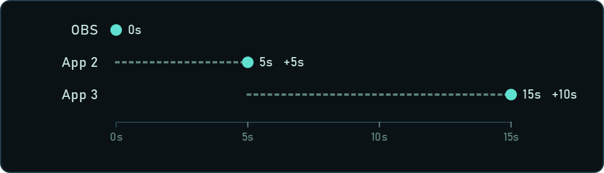</p>

- Menjalankan aplikasi sesuai urutan di pengaturan, masing-masing "jeda detik setelah aplikasi sebelumnya dijalankan". Tile aplikasi berikutnya berkedip oranye, dengan `NEXT ▸ nama detik` di bawahnya.
- Taruh DAW dan tool VB-Audio di akhir dengan jeda lebih panjang agar tidak berebut perangkat audio.
- **Setelah urutan selesai**: "Tidak melakukan apa-apa / Minimalkan ke taskbar / Sembunyikan". Dijalankan setelah semua aplikasi dipastikan berjalan (menunggu hingga 60 detik). Jika ada yang gagal atau belum berjalan, launcher tetap tampil.
- **Tombol ▶**: tersembunyi secara bawaan. Tampilkan dengan ⚙ → "Tombol urutan". Meskipun tersembunyi, urutan tetap bisa dimulai dari menu klik kanan atau tray.
- **Startup**: aktifkan ⚙ → "Startup" agar launcher berjalan saat login Windows dan langsung menjalankan urutan.

### Mode D&D

<p>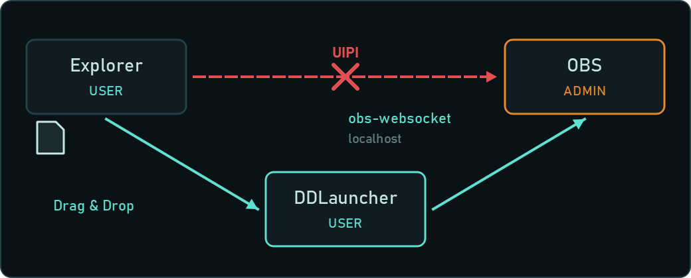</p>

Saat OBS berjalan sebagai administrator, file yang dijatuhkan dari Explorer tidak sampai ke OBS. DDLauncher berjalan dengan hak akses normal, menerima file itu, lalu meneruskannya ke OBS lewat obs-websocket, jadi tetap bisa ditambahkan.

- Jatuhkan file gambar, video, atau audio ke ruang D&D (atau ke launcher) untuk menambahkannya sebagai source ke scene OBS yang dipilih (scene program saat ini jika dikosongkan). Menjatuhkan ke launcher bisa dimatikan di ⚙ → "Jatuhkan ke launcher". Jika kamu menjatuhkan banyak file sekaligus (bawaan: 5 atau lebih), launcher bertanya dulu sebelum menambahkannya; ubah jumlahnya di ⚙ → "Konfirmasi saat menjatuhkan banyak file". Aktifkan ⚙ → "Folder / file campuran" untuk menjatuhkan seluruh folder dan memilih jenis yang ditambahkan (gambar, video, audio), serta mengatur ekstensi file untuk tiap jenis. Di ⚙ → "Source yang ditambahkan lewat D&D" kamu bisa mengatur source baru: tampil atau tersembunyi, langsung diputar atau berhenti (atau hanya file pertama yang diputar), volume, bisu, ulangi, pemantauan audio, sesuaikan layar, dan nama source. Jika nama sudah dipakai di OBS, nomor ditambahkan otomatis, atau kamu bisa memilih agar ditanya dulu (tambah nomor, ganti nama, tempatkan source yang ada, atau lewati).
  - "Sesuaikan layar" dan **[Image Resize Reader for OBS](https://github.com/ChromeBread/Image-Resize-Reader-for-OBS/blob/main/README.id.md)** (skrip OBS dari developer yang sama, yang menyesuaikan gambar dan video ke kanvas begitu ditambahkan): jika kamu memakainya, matikan "Sesuaikan layar". Source yang ditambahkan DDLauncher juga disesuaikan oleh Image Resize Reader, jadi jika keduanya aktif posisinya bisa bergeser atau terpotong.
- Dalam mode D&D, launcher mengabaikan margin dan menempel ke tepi layar, agar file tidak jatuh ke celah dan masuk ke jendela lain. Matikan dengan ⚙ → "Posisi saat D&D".
- Ruang D&D muncul tepat di samping launcher, menempel tetapi tidak menutupinya. Seret salah satu sudut bergaris untuk mengubah ukurannya, atau seret bagian lain untuk memindahkannya (di ⚙ → "Ubah ukuran ruang D&D" kamu bisa mengubah ukuran dari sisi juga). Ukuran dan posisi diingat; bila dijatuhkan di atas launcher, ruang itu bergeser menempel ke sisi launcher yang terdekat. Klik kanan untuk mengembalikan ukuran atau menaruhnya kembali di samping launcher. Jika ruang D&D hilang, pakai "Kembalikan ruang D&D ke samping launcher (ukuran bawaan)" di ⚙.

### Cara membaca tampilan

<p>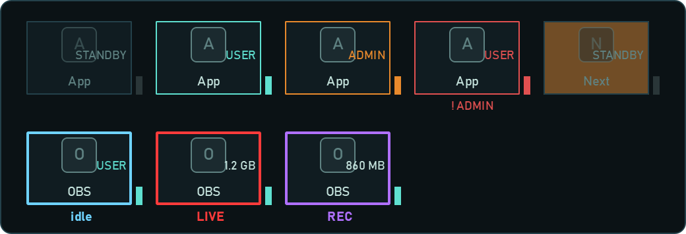</p>

- **Kanan atas tile**: `ADMIN` = berjalan sebagai administrator, `USER` = berjalan dengan hak akses normal, `STANDBY` = berhenti, `NO PATH` = path belum diatur
- **Warna lampu**: abu-abu = berhenti, hijau = berjalan (hak akses normal), oranye = berjalan (administrator), merah = diatur sebagai admin tetapi berjalan dengan hak akses normal
- **Bingkai tile OBS**: biru muda = tidak streaming, merah = sedang streaming, ungu = hanya merekam. Saat streaming / merekam, jumlah data yang terkirim tampil di kanan bawah ikon. Status tetap terlihat meskipun jendela OBS ditutup.

### Pengaturan

<details><summary>Tangkapan layar tab "Umum / OBS" (semua pengaturan)</summary>

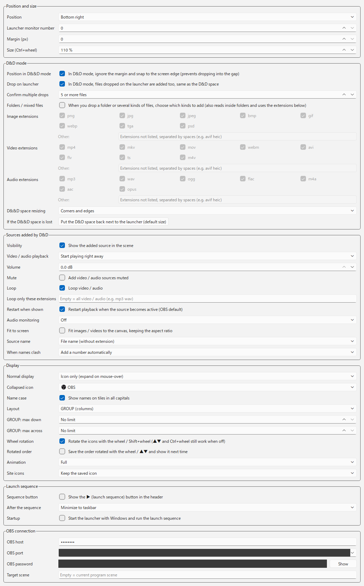

</details>

- **Aplikasi di launcher**: seret baris (atau gunakan ↑↓) untuk mengubah urutan. Arahkan kursor ke judul kolom untuk penjelasan.
  - "+ Tambah aplikasi…" memilih exe atau pintasan lalu mengisi nama dan path-nya. "+ Tambah alamat web" menambahkan baris untuk URL; kolom "Browser" memilih browser yang membukanya (browser default bila dibiarkan). Nama di ubin ditampilkan dengan huruf kapital; untuk menampilkannya sesuai ketikan, matikan ⚙ → "Huruf nama".
  - Klik kanan sebuah baris untuk memilih yang ingin diedit (kolom teks siap diketik, centang berganti, daftar pilihan terbuka), atau untuk memilih aplikasi / gambar ikon.<br>
    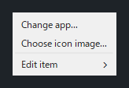
  - Jika "Gambar ikon" kosong, ikon exe yang dipakai, atau ikon situs bila path berupa URL. Isi "Gambar ikon" dengan alamat web untuk memakai ikon situs itu (atau gambarnya langsung, untuk alamat gambar). Ikon situs diunduh sekali dan disimpan di PC ini, jadi jika situs mengganti ikonnya, yang lama tetap dipakai; atur ⚙ → "Ikon situs" ke "Ambil ulang setiap mulai" agar diperbarui setiap DDLauncher dijalankan.
  - Baris yang dihapus bisa dikembalikan dengan ↶ (Ctrl+Z). Linimasa di bawah tabel menunjukkan berapa detik setelah mulai tiap aplikasi dijalankan.
  - "Pindah ke monitor" memindahkan jendela aplikasi ke monitor itu setelah dijalankan. Aplikasi yang dijalankan sebagai administrator tidak bisa dipindahkan karena batasan Windows.<br>
    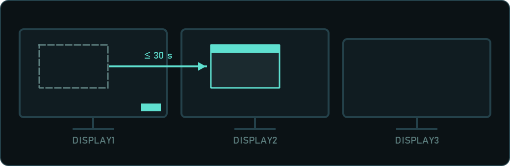
- **Port**: daftarkan port yang dipakai untuk melihat apakah kosong, dipakai, atau bentrok (dipakai proses tak terduga, atau terdaftar dua kali). "Bebaskan" menutup proses yang memakai port itu (dengan konfirmasi). "Deteksi" menambahkan port yang dipakai aplikasi terdaftar (OBS dari pengaturan WebSocket-nya, aplikasi lain saat sedang berjalan). Sebagian penampil komentar dan aplikasi pembaca teks yang populer di kalangan streamer dibaca dari file pengaturannya, sehingga tetap ditemukan walau tertutup. Anda memilih port mana yang ditambahkan, dan akan diberi tahu bila dua aplikasi yang saling terhubung memakai port yang berbeda.<br>
  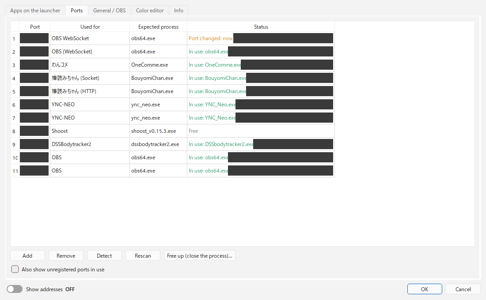
- **Editor warna**: opasitas, warna (bawaan / kustom) dan enam templat. Perubahan langsung tampil di launcher, dan Batal mengembalikannya.<br>
  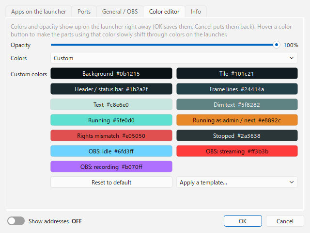
- **Info**: bahasa tampilan, versi, tanggal build, nama pengembang, dan tombol Debug Mode.
  - **Debug Mode**: ekspor / impor pengaturan, dan lainnya.

## Mencopot

- **Versi installer**: copot DDLauncher dari Pengaturan Windows → Aplikasi. Di awal akan ditanya apakah ingin memakai pencopot aman untuk mengekspor atau menghapus pengaturan.
- **Versi standalone**: untuk ikut menghapus pengaturan, jalankan `DDLauncher-Uninstall.exe` dulu, lalu hapus foldernya.
- **Pencopot aman** (`DDLauncher-Uninstall.exe`): ekspor pengaturan dulu, periksa yang ditemukan (folder pengaturan, file `DDLauncher*.exe` termasuk versi lama, dan entri mulai otomatis Windows), lalu pindahkan hanya yang dicentang ke Recycle Bin. File yang tidak terkait DDLauncher tidak pernah ditampilkan. Folder bersama `%APPDATA%\CBApps\` hanya dihapus jika kosong.

## Catatan

- Pengaturan disimpan di `%APPDATA%\CBApps\DDLauncher\`. Jika ada pengaturan di lokasi lama `%APPDATA%\DDLauncher\`, pengaturan itu disalin otomatis saat pertama kali dijalankan. Folder lama dibiarkan, jadi versi lama tetap bisa memakainya (perubahan setelah penyalinan tidak terbawa ke versi lama).
- Aplikasi yang diatur sebagai admin menampilkan konfirmasi UAC setiap kali dijalankan (termasuk saat startup).
- Beberapa aplikasi mengabaikan "Mulai diminimalkan". Untuk OBS, mengisi `--minimize-to-tray` di "Opsi peluncuran" lebih andal.
- Bantuan di dalam aplikasi (`?`) menjelaskan untung-rugi menjalankan sebagai administrator, mengapa drag & drop tidak bisa, dan cara mengatasi layar hitam.

<p>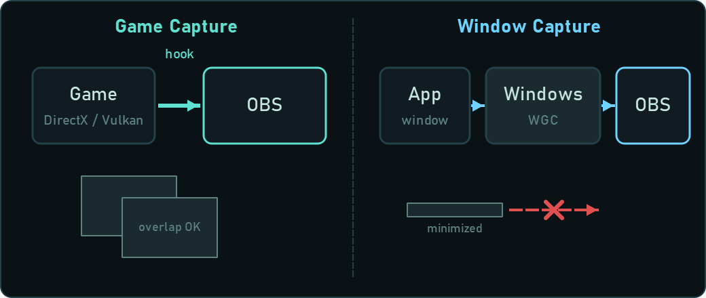</p>

## Lisensi

GPL-3.0 ([LICENSE](LICENSE)). Lisensi pustaka yang disertakan (PySide6 / Qt, obsws-python, dll.) ada di [THIRD-PARTY-LICENSES.txt](THIRD-PARTY-LICENSES.txt).

## Untuk developer

### Menjalankan dari kode sumber

```powershell
py -m venv .venv
.venv\Scripts\pip install -r requirements.txt
.venv\Scripts\pythonw main.py
```

Untuk membuat versi folder (`dist\DDLauncher\`) dan installer (installer memerlukan Inno Setup 6):

```powershell
.venv\Scripts\pip install pyinstaller
.venv\Scripts\pyinstaller DDLauncher.spec
iscc /DAppVersion=1.0.0 installer\DDLauncher.iss
```

### Daftar file

| File | Peran |
|---|---|
| `main.py` | Titik masuk. Menyimpan pengaturan dan membuat / membuat ulang jendela launcher. Memeriksa status aplikasi sekaligus setiap 2 detik. |
| `launcher_window.py` | Jendela satu launcher (penempatan di pojok, tile, tutup / buka, mode D&D, menu) |
| `sequencer.py` | Urutan peluncuran (urutan, jeda, mencegah dijalankan dua kali) |
| `winproc.py` | Kode khusus Windows (menjalankan normal / admin, mendeteksi proses berhak tinggi, registrasi startup, port) |
| `obs_bridge.py` | Menambah source dan membaca status streaming lewat obs-websocket 5 (berjalan di thread terpisah agar tampilan tidak macet) |
| `config.py` | Membaca / menulis pengaturan (melengkapi nilai bawaan, penyimpanan yang aman saat mati mendadak, migrasi dari lokasi lama) |
| `i18n.py` / `locales/` | Bahasa tampilan. Teks tampilan di `locales/<bahasa>.json`, bantuan di `locales/help/<bahasa>.html` |
| `about.py` | Tanggal build (di exe ditulis oleh `DDLauncher.spec`) dan format tanggal tiap bahasa |
| `theme.py` / `settings_dialog.py` | Tampilan, jendela pengaturan |
| `uninstaller.py` | Uninstaller aman (`DDLauncher-Uninstall.exe`) |
| `startup_items.py` | Membaca dan mengubah entri startup Windows (Run di registry dan folder Startup; dicadangkan sebelum diubah) |

- **Pemisahan hak akses**: launcher sendiri berjalan dengan hak akses normal. Launcher menerima drop dari Explorer dan meneruskan path file ke OBS (yang berjalan sebagai administrator) lewat WebSocket localhost. Lalu lintas WebSocket tidak dibatasi UIPI, jadi tetap sampai meskipun hak aksesnya berbeda.
- **Beberapa launcher**: `launchers` di file pengaturan adalah array. Setiap elemen membuat satu jendela (tambahkan dengan mengedit JSON secara langsung).

Pengujian:

```powershell
.venv\Scripts\python tests\test_core.py
```
