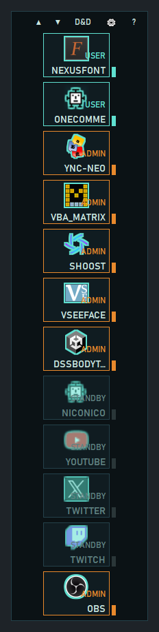
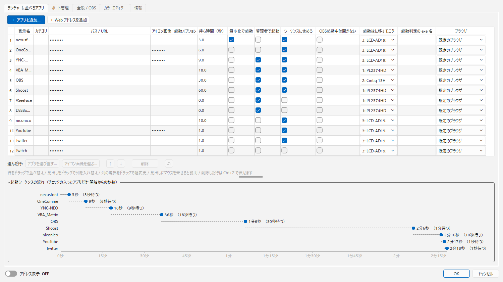
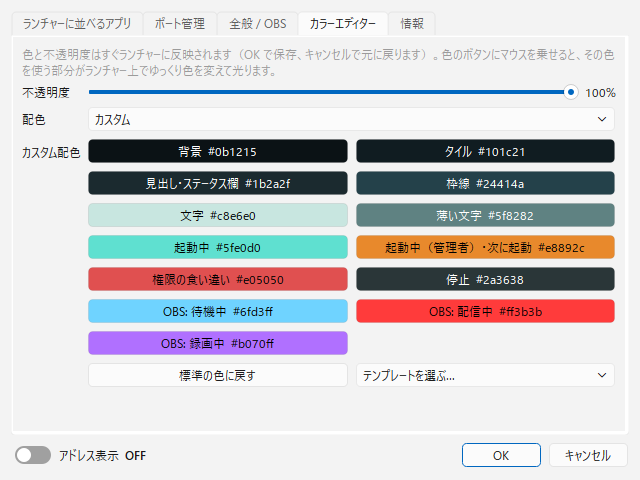

# DDLauncher

[English](README.md) | **日本語** | [한국어](README.ko.md) | [Bahasa Indonesia](README.id.md) | [Français](README.fr.md) | [繁體中文](README.zh-TW.md)

配信者向けの軽量な常駐ランチャー（Windows）です。画面の隅に小さく置いておけます。

> [!TIP]
> **管理者権限の OBS にも、ファイルのドラッグ＆ドロップでソースを追加できます。**
> 普通は OBS を管理者権限で動かすと、Windows の制限でエクスプローラーからのドラッグ＆ドロップが効かなくなります。DDLauncher はランチャーに落としたファイルを obs-websocket 経由で OBS に渡すので、この制限を受けません。

- OBS などのアプリを決めた順番で、間隔を空けて自動起動します。起動中のアプリは二重に起動しません。
- 各アプリが起動中か、管理者権限で動いているかをランプの色で表示します。
- 普段は小さなアイコン 1 個だけを隅に置き、マウスを乗せたときだけ開きます。

<p>


</p>


## 動作環境

- Windows 10 / 11
- OBS Studio 28 以降（obs-websocket 5 が標準で入っているバージョン）
- 表示言語: English / 日本語 / 한국어 / Bahasa Indonesia / Français / 繁體中文

## ダウンロードとインストール

[Releases](https://github.com/ChromeBread/DDLauncher/releases/latest) から、どちらかをダウンロードします。

| 版 | ファイル | 向いている使い方 |
|---|---|---|
| インストーラー版 | `DDLauncher-0.2.1-windows-x64-setup.exe` | スタートメニューに登録し、Windows の「アプリ」から削除したい |
| スタンドアロン版 | `DDLauncher-0.2.1-windows-x64-portable.zip` | インストールせずに使いたい。フォルダごと消せば削除できる |

- スタンドアロン版は、zip を好きな場所に展開して `DDLauncher.exe` を起動します。
- 署名の無い exe なので、初めて起動するときに Windows SmartScreen（「Windows によって PC が保護されました」）やウイルス対策ソフトが警告することがあります。「詳細情報」→「実行」で起動できます。気になる場合は、下の「開発者向け」にある「ソースから動かす」で中身を確かめてから使ってください。
- どちらの版も、設定は `%APPDATA%\CBApps\DDLauncher\` に保存します。

## OBS 側の準備

1. OBS の「ツール」→「WebSocket サーバー設定」で「WebSocket サーバーを有効にする」をオンにします。
2. ポートとパスワードを控え、ランチャーの ⚙ →「全般 / OBS」に入力します。

## 使い方

### 基本の操作

- **アイコンを左クリック**: アプリを起動します（起動中なら何もしません）。**右クリック**: 管理者／通常権限を選んで起動します。
- **OBS起動中は開かない**（アプリごと、既定はオン）: OBS が起動している間は、アイコンをクリックしてもアプリやブラウザを開きません（配信中の押し間違い防止）。アイコンの右クリックメニューからは開けます。⚙ →「ランチャーに並べるアプリ」でアプリごとにオフにできます。
- **ランチャーの余白を右クリック**: 配置（4 隅）、起動シーケンス、D&D モード、常に展開、最前面に表示（ランチャー / D&D スペースそれぞれ）、設定、終了のメニューを開きます。
- **ヘッダのボタン**: `▲▼` 並びを回す / `D&D` モード切替 / `▶` シーケンス開始・中止（設定で表示した場合）/ `⚙` 設定 / `?` ヘルプ
- **トレイアイコン**: クリックでランチャーを表示します。右クリックで、シーケンス開始と終了ができます。
- **設定 / ヘルプの画面**: ランチャーに重ならない位置（上・下・左・右の空いている所）に開きます。

### 表示

- **普段の表示**（⚙ →「全般」、または余白の右クリックメニュー「常に展開」）
  - **アイコンのみ**（既定）: 普段は `DD` のアイコン 1 個だけを隅に置きます。マウスを乗せる（またはクリックする）と全体が開き、マウスが離れて 0.8 秒たつとアイコンに戻ります。
  - **常に展開**: マウスに関係なく、全体を開いたままにします。
  - D&D モード中と起動シーケンス中は、どちらの設定でも開いたままにします（ドロップ先と残り秒数を見せるため）。
- **表示モード**（⚙ →「全般」）
  - **LINEAR**: 未実装です（調整中）。
  - **GROUP**: 配置コーナーの角から縦に並べます。「GROUP: 縦の上限」を決めると、超えた分は内側に次の列を作ります。「GROUP: 横の上限」で列の数を抑えられます（そのときは縦が伸びます）。0 = 無制限（縦一列）。
  - どちらも、マウスホイール（または ▲▼）で並びを輪のように回せます。回した並びは「回した並び」をオンにすると保存されます。
- **カテゴリ**: 同じカテゴリのアプリは 1 枠に重なり、マウスを乗せると残りが画面の内側へ横に出てきます（例: カテゴリ「配信先」に YouTube → ニコニコ生放送 → Twitch の順で登録）。重なったタイルの上で Shift+ホイール（またはホイールのチルト）、または横に出た列の ◀▶ で、表に出すアプリを入れ替えられます。
- **大きさ**: ランチャー上で **Ctrl+マウスホイール**、または ⚙ →「全般」の「大きさ」で 50〜250% に変更できます。画面からはみ出す大きさにすると、自動で縮小します。
- **畳んだときのアイコン**: 既定は `DD` のアイコンです。⚙ →「全般」で、登録したアプリやウェブページのアイコンに変えられます。
- **ホイールで回す**: ホイールでアイコンが動くのが邪魔なときは ⚙ →「全般」でオフにできます。▲▼ と Ctrl+ホイールはそのまま使えます。
- **表示言語**: ⚙ →「情報」の「Language」で選べます。既定の「自動」は OBS の表示言語に合わせます（OBS の設定が見つからなければ Windows の言語）。対応していない言語では English で表示します。

### 起動シーケンス

- 設定画面の並び順で、「前のアプリを起動してから 待ち時間（秒） 後」に次を起動します。次に起動するアプリのタイルがオレンジに点滅し、下に `NEXT ▸ 名前 残り秒` を表示します。
- DAW や VB-Audio 系は最後に置き、待ち秒数を長めにするとオーディオデバイスの取り合いを避けやすくなります。
- **シーケンス完了後**: 「何もしない / タスクバーに最小化 / 隠す」から選べます。全アプリの起動を確認してから実行し（最大 60 秒待ちます）、失敗や未起動があれば表示したまま残します。
- **▶ ボタン**: 既定では非表示です。⚙ →「シーケンスボタン」で表示できます。非表示でも、右クリックメニューとトレイから開始できます。
- **スタートアップ**: ⚙ →「スタートアップ」をオンにすると、Windows のログオン時に起動し、そのままシーケンスを実行します。

### D&D モード

- 画像・動画・音声ファイルを D&D スペース（またはランチャー）にドロップすると、OBS の指定したシーン（空欄なら現在のプログラムシーン）にソースとして追加します。ランチャーへのドロップは ⚙ →「ランチャーへのドロップ」でオフにできます。一度にたくさんのファイル（既定は 5 個以上）をドロップしたときは、追加する前に確認します。数は ⚙ →「まとめてドロップしたときの確認」で変えられます。⚙ →「フォルダ・複数種類のドロップ」をオンにすると、フォルダごとドロップでき、画像・映像・音楽のどれを読み込むかを選べます。読み込む拡張子も種類ごとに指定できます。⚙ →「D&D で追加するソース」で、追加したソースの表示 / 非表示、再生 / 停止（先頭の 1 個だけ再生も可）、音量、ミュート、ループ、音声モニタリング、画面に合わせるか、ソース名の付け方を決められます。
  - 「画面に合わせる」と **Image Resize Reader for OBS**: Image Resize Reader を使っている場合は、「画面に合わせる」はオフにしてください。DDLauncher から追加したソースも Image Resize Reader が合わせるので、両方オンだと位置がずれたり、はみ出したりします。
- D&D モード中は、余白の設定を無視して画面端にぴったり付けます（余白に落として別のウィンドウへドロップする事故を防ぐため）。⚙ →「D&D時の配置」でオフにできます。
- D&D スペースはランチャーのすぐ隣に、くっつけて重ならないように出ます。四隅の斜線をドラッグすると大きさを、ほかの所をドラッグすると位置を変えられます（⚙ →「D&D スペースの大きさ変更」で、四辺からも変えられるようにできます）。大きさと位置は覚えます。ランチャーに重なる所へ動かすと、ランチャーの一番近い辺にくっつく位置へずれます。右クリックで「大きさを元に戻す」「ランチャーの隣に戻す」ができます。見失ったときは、⚙ の「D&D スペースを既定の大きさでランチャーの隣に戻す」で戻せます。

### 表示の見方

- **タイル右上**: `ADMIN` = 管理者権限で起動中、`USER` = 通常権限で起動中、`STANDBY` = 停止、`NO PATH` = パス未設定
- **ランプの色**: 灰 = 停止、緑 = 起動中（通常権限）、橙 = 起動中（管理者権限）、赤 = 管理者指定なのに通常権限で動作中
- **OBS タイルの縁**: 水色 = 配信していない、赤 = 配信中、紫 = 録画のみ。配信中 / 録画中は、アイコンの右下に送信したデータ量を表示します。OBS のウィンドウを閉じていても状態が分かります。

### 設定画面

- **ランチャーに並べるアプリ**: 行をドラッグ（または ↑↓）で並べ替えます。見出しにマウスを乗せると各列の説明が出ます。
  - 「アイコン画像」が空欄なら exe のアイコン、パスが URL ならサイトのアイコンを使います。アイコン画像に Web アドレスを入れると、そのサイトのアイコン（画像のアドレスならその画像）を使います。
  - 削除した行は「元に戻す」（Ctrl+Z）で戻せます。表の下の時間グラフで、各アプリが開始から何秒後に起動するかを確認できます。
  - 「起動後に移すモニタ」を選ぶと、起動後にウィンドウをそのモニタへ移します。管理者権限で起動したアプリは Windows の制限により移せません。
- **ポート管理**: 使うポートを登録すると、空き / 使用中 / 衝突（想定外のプロセスが使用中、または重複登録）を表示します。「解放」はそのポートを使っているプロセスを終了します（確認あり）。「自動取得」で、登録アプリが使うポートを追加できます（OBS は WebSocket の設定から、ほかのアプリは起動中のものから）。配信でよく使うコメントビューアや読み上げソフトの一部は、設定ファイルから読むので、起動していなくても見つかります。見つかったポートから追加するものを選べます。連携しているアプリ同士でポートが食い違っていれば知らせます。この PC の IP アドレスが固定か可変かもメモできます。「自動判定」を押すと、有線 / Wi-Fi が IP アドレスを自動で受け取る設定（DHCP）かどうかだけを調べて入れます。IP アドレスそのものは取得しません。ルーター側の DHCP 予約は、自動判定では「可変」に見えます。
- **カラーエディター**: 不透明度、配色（標準 / カスタム）、6 種類のテンプレートを選べます。変えた色はすぐランチャーに反映され、キャンセルで元に戻ります。
- **情報**: 表示言語、バージョン、ビルド日、開発者の表記、Debug Mode の切り替えがあります。
  - **Debug Mode**: 設定のエクスポート / インポートなど。

## アンインストール

- **インストーラー版**: Windows の「設定」→「アプリ」から DDLauncher をアンインストールします。始めに、設定のエクスポートや削除ができる安全アンインストーラーを使うか聞かれます。
- **スタンドアロン版**: 設定も消す場合は先に `DDLauncher-Uninstall.exe` を起動し、そのあとフォルダごと削除します。
- **安全アンインストーラー**（`DDLauncher-Uninstall.exe`）: 先に設定をエクスポートでき、見つかったもの（設定フォルダ、旧バージョンを含む `DDLauncher*.exe`、Windows の自動起動の登録）を一覧で確認してから、チェックしたものだけをゴミ箱へ移します。DDLauncher と関係ないファイルは一覧に出ません。共用の `%APPDATA%\CBApps\` フォルダは、空になったときだけ片付けます。

## 注意

- 設定の保存場所は `%APPDATA%\CBApps\DDLauncher\` です。以前の保存場所 `%APPDATA%\DDLauncher\` に設定があれば、初めて起動したときに自動でコピーして引き継ぎます。以前のフォルダはそのまま残すので、前のバージョンに戻しても設定は使えます（引き継ぎ後の変更は前のバージョンには反映されません）。
- 管理者指定のアプリは、起動のたびに UAC の確認が出ます（スタートアップ時も同じです）。
- 「最小化で起動」の指定を無視するアプリもあります。OBS は「起動オプション」に `--minimize-to-tray` を使う方が確実です。
- 管理者権限で動かす利点と欠点、D&D ができなくなる理由、黒画面の対処はアプリ内のヘルプ（`?`）にまとめています。

## ライセンス

GPL-3.0（[LICENSE](LICENSE)）。同梱しているライブラリ（PySide6 / Qt、obsws-python など）のライセンスは [THIRD-PARTY-LICENSES.txt](THIRD-PARTY-LICENSES.txt) にまとめています。

## 開発者向け

### ソースから動かす

```powershell
py -m venv .venv
.venv\Scripts\pip install -r requirements.txt
.venv\Scripts\pythonw main.py
```

フォルダ版（`dist\DDLauncher\`）とインストーラーを作る場合（インストーラーには Inno Setup 6 が必要です）:

```powershell
.venv\Scripts\pip install pyinstaller
.venv\Scripts\pyinstaller DDLauncher.spec
iscc /DAppVersion=0.2.1 installer\DDLauncher.iss
```

### ファイル構成

| ファイル | 役割 |
|---|---|
| `main.py` | エントリポイント。設定を持ち、ランチャーウィンドウを作成・再作成します。状態確認は 2 秒ごとにまとめて行います。 |
| `launcher_window.py` | ランチャー 1 つ分の画面（隅への配置、タイル、畳む / 展開、D&D モード、メニュー） |
| `sequencer.py` | 起動シーケンス（順番・待ち時間・二重起動防止） |
| `winproc.py` | Windows 固有の処理（通常 / 管理者での起動、他プロセスの昇格判定、スタートアップ登録、ポート） |
| `obs_bridge.py` | obs-websocket 5 でのソース追加と配信状態の取得（別スレッドで実行し、画面を止めません） |
| `config.py` | 設定の読み書き（既定値の補完、途中で落ちても壊れない保存、旧保存場所からの引き継ぎ） |
| `i18n.py` / `locales/` | 表示言語。`locales/<言語>.json` に画面の文字、`locales/help/<言語>.html` にヘルプ |
| `about.py` | ビルド日（exe では `DDLauncher.spec` が書き込みます）と、言語ごとの日付の書き方 |
| `theme.py` / `settings_dialog.py` | 見た目、設定画面 |
| `uninstaller.py` | 安全アンインストーラー（`DDLauncher-Uninstall.exe`） |
| `startup_items.py` | Windows のスタートアップ項目の読み書き（レジストリの Run とスタートアップフォルダ。変更前にバックアップ） |

- **権限の分け方**: ランチャー自体は通常権限で動かします。エクスプローラーからのドロップを受け取り、そのファイルパスを localhost の WebSocket で管理者権限の OBS に渡します。WebSocket の通信は UIPI の制限を受けないため、権限が違っても届きます。
- **複数ランチャー**: 設定ファイルの `launchers` は配列です。要素を増やすと、その数だけウィンドウが作られます（今は設定画面から追加できないので、JSON を直接編集してください）。

テスト:

```powershell
.venv\Scripts\python tests\test_core.py
```
