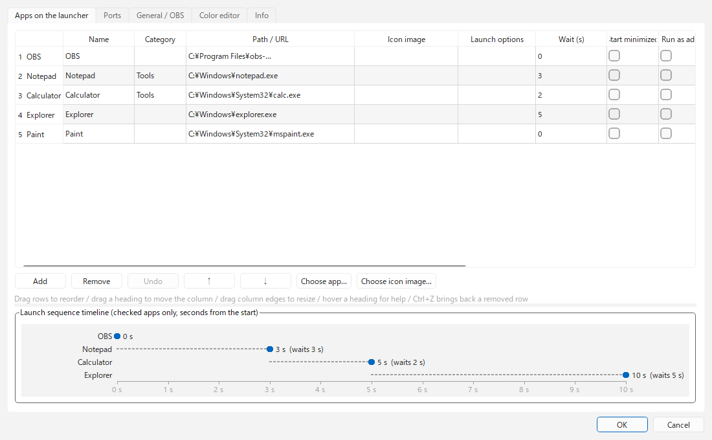
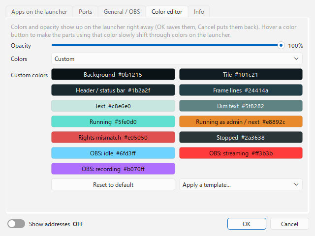

# DDLauncher

[English](README.md) | [日本語](README.ja.md) | **한국어** | [Bahasa Indonesia](README.id.md) | [Français](README.fr.md) | [繁體中文](README.zh-TW.md)

방송인을 위한 가벼운 상주형 런처 (Windows)입니다. 화면 구석에 작게 놓아 둘 수 있습니다.

> [!TIP]
> **관리자 권한의 OBS에도 파일을 드래그 앤 드롭해 소스를 추가할 수 있습니다.**
> 보통 OBS를 관리자 권한으로 실행하면 Windows의 제한 때문에 탐색기에서 드래그 앤 드롭이 되지 않습니다. DDLauncher는 런처에 놓은 파일을 obs-websocket으로 OBS에 넘기므로 이 제한을 받지 않습니다.

- OBS 등의 앱을 정한 순서대로, 간격을 두고 자동 실행합니다. 이미 실행 중인 앱은 두 번 실행하지 않습니다.
- 각 앱이 실행 중인지, 관리자 권한으로 실행 중인지 램프 색으로 표시합니다.
- 평소에는 작은 아이콘 하나만 구석에 두고, 마우스를 올렸을 때만 펼칩니다.

<p>


</p>


## 동작 환경

- Windows 10 / 11
- OBS Studio 28 이상 (obs-websocket 5가 기본으로 들어 있는 버전)
- 표시 언어: English / 日本語 / 한국어 / Bahasa Indonesia / Français / 繁體中文

## 다운로드와 설치

[Releases](https://github.com/ChromeBread/DDLauncher/releases/latest)에서 둘 중 하나를 내려받습니다.

| 버전 | 파일 | 이런 경우에 |
|---|---|---|
| 설치판 | `DDLauncher-0.2.1-windows-x64-setup.exe` | 시작 메뉴에 등록하고 Windows의 "앱"에서 제거하고 싶을 때 |
| 단독 실행판 | `DDLauncher-0.2.1-windows-x64-portable.zip` | 설치 없이 쓰고 싶을 때. 폴더째 지우면 제거됩니다 |

- 단독 실행판은 zip을 원하는 곳에 풀고 `DDLauncher.exe`를 실행합니다.
- 서명이 없는 exe라서 처음 실행할 때 Windows SmartScreen("Windows의 PC 보호")이나 백신이 경고할 수 있습니다. "추가 정보" → "실행"으로 실행할 수 있습니다. 걱정되면 아래 "개발자용"의 "소스에서 실행"으로 내용을 확인한 뒤 사용하세요.
- 두 버전 모두 설정은 `%APPDATA%\CBApps\DDLauncher\`에 저장합니다.

## OBS 쪽 준비

1. OBS의 "도구" → "WebSocket 서버 설정"에서 "WebSocket 서버 사용"을 켭니다.
2. 포트와 비밀번호를 확인해 런처의 ⚙ → "일반 / OBS"에 입력합니다.

## 사용 방법

### 기본 조작

- **아이콘 좌클릭**: 앱을 실행합니다 (이미 실행 중이면 아무것도 하지 않습니다). **우클릭**: 관리자 / 일반 권한을 골라 실행합니다.
- **OBS 실행 중 잠금** (앱별, 기본 켜짐): OBS가 실행 중인 동안에는 아이콘을 클릭해도 앱이나 브라우저를 열지 않습니다 (방송 중 잘못 누르기 방지). 아이콘의 우클릭 메뉴에서는 열 수 있습니다. ⚙ → "런처에 놓을 앱"에서 앱별로 끌 수 있습니다.
- **런처 여백 우클릭**: 위치 (네 구석), 실행 시퀀스, D&D 모드, 항상 펼치기, 항상 위에 표시 (런처 / D&D 공간 각각), 설정, 종료 메뉴를 엽니다.
- **헤더 버튼**: `▲▼` 순서 돌리기 / `D&D` 모드 전환 / `▶` 시퀀스 시작·중지 (설정에서 표시한 경우) / `⚙` 설정 / `?` 도움말
- **트레이 아이콘**: 클릭하면 런처를 표시합니다. 우클릭으로 시퀀스 시작과 종료를 할 수 있습니다.
- **설정 / 도움말 창**: 런처와 겹치지 않는 위치 (위·아래·왼쪽·오른쪽 중 빈 곳)에 열립니다.

### 표시

- **평소 표시** (⚙ → "일반", 또는 여백 우클릭 메뉴 "항상 펼치기")
  - **아이콘만** (기본값): 평소에는 `DD` 아이콘 하나만 구석에 둡니다. 마우스를 올리거나 클릭하면 전체가 펼쳐지고, 마우스가 떠나고 0.8초 뒤 아이콘으로 돌아갑니다.
  - **항상 펼치기**: 마우스와 관계없이 펼친 상태를 유지합니다.
  - D&D 모드 중과 실행 시퀀스 중에는 어느 설정이든 펼친 상태를 유지합니다 (드롭할 곳과 남은 초를 보여 주기 위해).
- **표시 모드** (⚙ → "일반")
  - **LINEAR**: 아직 구현되지 않았습니다(조정 중).
  - **GROUP**: 배치한 구석에서 세로로 늘어놓습니다. "GROUP: 세로 상한"을 정하면 넘는 만큼은 안쪽에 다음 열을 만듭니다. "GROUP: 가로 상한"으로 열 개수를 제한할 수 있습니다(그때는 세로가 늘어납니다). 0 = 무제한(세로 한 줄).
  - 두 모드 모두 마우스 휠 (또는 ▲▼)로 순서를 고리처럼 돌릴 수 있습니다. "돌린 순서"를 켜면 돌린 순서가 저장됩니다.
- **카테고리**: 같은 카테고리의 앱은 한 칸에 겹쳐지고, 마우스를 올리면 나머지가 화면 안쪽으로 옆으로 펼쳐집니다 (예: 카테고리 "플랫폼"에 YouTube → Twitch → CHZZK 순서로 등록). 겹쳐진 타일 위에서 Shift+휠 (또는 휠 틸트), 또는 펼쳐진 줄의 ◀▶로 앞에 보일 앱을 바꿀 수 있습니다.
- **크기**: 런처 위에서 **Ctrl+마우스 휠**, 또는 ⚙ → "일반"의 "크기"로 50~250%로 바꿀 수 있습니다. 화면을 넘는 크기가 되면 자동으로 줄입니다.
- **접었을 때 아이콘**: 기본은 `DD` 아이콘입니다. ⚙ → "일반"에서 등록한 앱이나 웹 페이지의 아이콘으로 바꿀 수 있습니다.
- **휠로 돌리기**: 휠로 아이콘이 움직이는 게 불편하면 ⚙ → "일반"에서 끌 수 있습니다. ▲▼와 Ctrl+휠은 그대로 쓸 수 있습니다.
- **표시 언어**: ⚙ → "정보"의 "Language"에서 고를 수 있습니다. 기본값 "자동"은 OBS의 표시 언어에 맞춥니다 (OBS 설정을 찾지 못하면 Windows 언어). 지원하지 않는 언어에서는 English로 표시합니다.

### 실행 시퀀스

- 설정 화면의 순서대로 "이전 앱을 실행한 뒤 대기 초 후"에 다음 앱을 실행합니다. 다음에 실행할 앱의 타일이 주황색으로 깜빡이고, 아래에 `NEXT ▸ 이름 남은 초`를 표시합니다.
- DAW나 VB-Audio 계열은 마지막에 두고 대기 시간을 길게 하면 오디오 장치 쟁탈을 피하기 쉽습니다.
- **시퀀스 완료 후**: "아무것도 안 함 / 작업 표시줄로 최소화 / 숨기기" 중에서 고릅니다. 모든 앱의 실행을 확인한 뒤 동작하며 (최대 60초 대기), 실패·미실행이 있으면 표시한 채로 둡니다.
- **▶ 버튼**: 기본은 숨김입니다. ⚙ → "시퀀스 버튼"으로 표시할 수 있습니다. 숨겨도 우클릭 메뉴와 트레이에서 시작할 수 있습니다.
- **시작 프로그램**: ⚙ → "시작 프로그램"을 켜면 Windows 로그인 시 런처를 실행하고 바로 시퀀스를 진행합니다.

### D&D 모드

- 이미지·영상·음악 파일을 D&D 공간 (또는 런처)에 드롭하면 OBS의 지정한 장면 (비워 두면 현재 프로그램 장면)에 소스로 추가합니다. 런처에 드롭하는 기능은 ⚙ → "런처에 드롭"에서 끌 수 있습니다. 한 번에 많은 파일 (기본값 5개 이상)을 드롭하면 추가하기 전에 확인합니다. 개수는 ⚙ → "한꺼번에 드롭할 때 확인"에서 바꿀 수 있습니다. ⚙ → "폴더·여러 종류 드롭"을 켜면 폴더째 드롭할 수 있고, 이미지·영상·음악 중 무엇을 읽어 올지 고를 수 있습니다. 읽어 올 확장자도 종류별로 지정할 수 있습니다. ⚙ → "D&D로 추가하는 소스"에서 추가한 소스의 표시 / 숨김, 재생 / 정지 (첫 번째 파일만 재생도 가능), 음량, 음소거, 반복, 오디오 모니터링, 화면에 맞추기, 소스 이름을 정할 수 있습니다.
  - "화면에 맞추기"와 **Image Resize Reader for OBS**: Image Resize Reader를 쓰고 있다면 "화면에 맞추기"는 꺼 두세요. DDLauncher로 추가한 소스도 Image Resize Reader가 맞추기 때문에, 둘 다 켜면 위치가 어긋나거나 화면 밖으로 나갑니다.
- D&D 모드 중에는 여백 설정을 무시하고 화면 가장자리에 딱 붙입니다 (여백에 떨어뜨려 다른 창에 드롭하는 사고를 막기 위해). ⚙ → "D&D 때의 위치"에서 끌 수 있습니다.
- D&D 공간은 런처 바로 옆에, 붙어 있지만 겹치지 않게 나타납니다. 네 모서리의 빗금을 드래그하면 크기를, 다른 곳을 드래그하면 위치를 바꿀 수 있습니다 (⚙ → "D&D 공간 크기 변경"에서 네 변으로도 바꿀 수 있게 할 수 있습니다). 크기와 위치는 기억합니다. 런처와 겹치는 곳으로 옮기면 런처의 가장 가까운 변에 붙는 위치로 비켜납니다. 우클릭으로 크기 되돌리기, 런처 옆으로 되돌리기를 할 수 있습니다. 찾을 수 없게 되면 ⚙의 "D&D 공간을 기본 크기로 런처 옆에 되돌리기"로 되돌릴 수 있습니다.

### 표시 보는 법

- **타일 오른쪽 위**: `ADMIN` = 관리자 권한으로 실행 중, `USER` = 일반 권한으로 실행 중, `STANDBY` = 정지, `NO PATH` = 경로 미설정
- **램프 색**: 회색 = 정지, 초록 = 실행 중 (일반 권한), 주황 = 실행 중 (관리자 권한), 빨강 = 관리자로 지정했는데 일반 권한으로 실행 중
- **OBS 타일 테두리**: 하늘색 = 방송 안 함, 빨강 = 방송 중, 보라 = 녹화만. 방송 중 / 녹화 중에는 아이콘 오른쪽 아래에 전송한 데이터 양을 표시합니다. OBS 창을 닫아 두어도 상태를 알 수 있습니다.

### 설정 화면

- **런처에 놓을 앱**: 행을 드래그 (또는 ↑↓)해 순서를 바꿉니다. 머리글에 마우스를 올리면 각 열의 설명이 나옵니다.
  - "아이콘 이미지"가 비어 있으면 exe 아이콘, 경로가 URL이면 사이트 아이콘을 씁니다. 아이콘 이미지에 웹 주소를 넣으면 그 사이트의 아이콘(이미지 주소면 그 이미지)을 씁니다.
  - 삭제한 행은 "되돌리기"(Ctrl+Z)로 되돌릴 수 있습니다. 표 아래 타임라인에서 각 앱이 시작 후 몇 초 뒤에 실행되는지 볼 수 있습니다.
  - "실행 후 이동할 모니터"를 고르면 실행 후 창을 그 모니터로 옮깁니다. 관리자 권한으로 실행한 앱은 Windows 제한 때문에 옮길 수 없습니다.
- **포트 관리**: 쓰는 포트를 등록하면 비어 있음 / 사용 중 / 충돌 (예상 밖의 프로세스가 사용 중, 또는 중복 등록)을 표시합니다. "해제"는 그 포트를 쓰는 프로세스를 종료합니다 (확인 있음). "자동 가져오기"로 등록한 앱이 쓰는 포트를 추가할 수 있습니다(OBS는 WebSocket 설정에서, 다른 앱은 실행 중일 때). 방송에서 자주 쓰는 댓글 뷰어나 읽어 주기 소프트웨어 일부는 설정 파일에서 읽기 때문에 실행하지 않아도 찾을 수 있습니다. 찾은 포트 중 추가할 것을 고를 수 있으며, 연동된 앱끼리 포트가 다르면 알려 줍니다. 이 PC의 IP 주소가 고정인지 유동인지도 메모할 수 있습니다. "자동 판정"을 누르면 유선 / Wi-Fi가 IP 주소를 자동으로 받는 설정(DHCP)인지만 확인해서 채웁니다. IP 주소 자체는 가져오지 않습니다. 공유기의 DHCP 예약은 자동 판정에서 "유동"으로 보입니다.
- **색상 편집기**: 불투명도, 색상(기본 / 사용자 지정), 6가지 템플릿을 고를 수 있습니다. 바꾼 색은 바로 런처에 반영되고, 취소하면 되돌아갑니다.
- **정보**: 표시 언어, 버전, 빌드 날짜, 개발자 표기, Debug Mode 전환이 있습니다.
  - **Debug Mode**: 설정 내보내기 / 가져오기 등.

## 제거

- **설치판**: Windows "설정" → "앱"에서 DDLauncher를 제거합니다. 처음에 설정을 내보내거나 지울 수 있는 안전 제거 프로그램을 쓸지 묻습니다.
- **단독 실행판**: 설정도 지우려면 먼저 `DDLauncher-Uninstall.exe`를 실행한 뒤 폴더째 삭제합니다.
- **안전 제거 프로그램** (`DDLauncher-Uninstall.exe`): 먼저 설정을 내보낼 수 있고, 찾은 항목(설정 폴더, 이전 버전을 포함한 `DDLauncher*.exe`, Windows 자동 시작 등록)을 목록으로 확인한 뒤 체크한 것만 휴지통으로 옮깁니다. DDLauncher와 관계없는 파일은 목록에 나오지 않습니다. 공용 `%APPDATA%\CBApps\` 폴더는 비었을 때만 정리합니다.

## 주의

- 설정은 `%APPDATA%\CBApps\DDLauncher\`에 저장됩니다. 이전 저장 위치 `%APPDATA%\DDLauncher\`에 설정이 있으면 처음 실행할 때 자동으로 복사해 이어받습니다. 이전 폴더는 그대로 남기므로 이전 버전으로 되돌려도 설정을 쓸 수 있습니다 (이어받은 뒤의 변경은 이전 버전에 반영되지 않습니다).
- 관리자로 지정한 앱은 실행할 때마다 UAC 확인이 나옵니다 (시작 프로그램으로 실행할 때도 같습니다).
- "최소화로 실행" 지정을 무시하는 앱도 있습니다. OBS는 "실행 옵션"에 `--minimize-to-tray`를 넣는 편이 확실합니다.
- 관리자 권한으로 실행할 때의 장단점, D&D를 할 수 없게 되는 이유, 검은 화면 대처법은 앱 안의 도움말 (`?`)에 정리해 두었습니다.

## 라이선스

GPL-3.0 ([LICENSE](LICENSE)). 함께 들어 있는 라이브러리(PySide6 / Qt, obsws-python 등)의 라이선스는 [THIRD-PARTY-LICENSES.txt](THIRD-PARTY-LICENSES.txt)에 정리했습니다.

## 개발자용

### 소스에서 실행

```powershell
py -m venv .venv
.venv\Scripts\pip install -r requirements.txt
.venv\Scripts\pythonw main.py
```

폴더판(`dist\DDLauncher\`)과 설치 파일을 만들 때 (설치 파일에는 Inno Setup 6이 필요합니다):

```powershell
.venv\Scripts\pip install pyinstaller
.venv\Scripts\pyinstaller DDLauncher.spec
iscc /DAppVersion=0.2.1 installer\DDLauncher.iss
```

### 파일 구성

| 파일 | 역할 |
|---|---|
| `main.py` | 진입점. 설정을 갖고 런처 창을 만들고 다시 만듭니다. 상태 확인은 2초마다 한꺼번에 합니다. |
| `launcher_window.py` | 런처 하나의 화면 (구석 배치, 타일, 접기 / 펼치기, D&D 모드, 메뉴) |
| `sequencer.py` | 실행 시퀀스 (순서·대기 시간·중복 실행 방지) |
| `winproc.py` | Windows 전용 처리 (일반 / 관리자 실행, 다른 프로세스의 권한 상승 판정, 시작 프로그램 등록, 포트) |
| `obs_bridge.py` | obs-websocket 5로 소스 추가와 방송 상태 가져오기 (별도 스레드에서 실행해 화면을 멈추지 않음) |
| `config.py` | 설정 읽기 / 쓰기 (기본값 보완, 도중에 꺼져도 깨지지 않는 저장, 이전 저장 위치에서 이어받기) |
| `i18n.py` / `locales/` | 표시 언어. `locales/<언어>.json`에 화면 문자, `locales/help/<언어>.html`에 도움말 |
| `about.py` | 빌드 날짜 (exe에서는 `DDLauncher.spec`이 기록)와 언어별 날짜 표기 |
| `theme.py` / `settings_dialog.py` | 외형, 설정 화면 |
| `uninstaller.py` | 안전한 제거 프로그램(`DDLauncher-Uninstall.exe`) |
| `startup_items.py` | Windows 시작 프로그램 항목 읽기와 변경 (레지스트리 Run과 시작프로그램 폴더. 변경 전에 백업) |

- **권한 분리**: 런처 자체는 일반 권한으로 실행합니다. 탐색기에서 드롭을 받아, 그 파일 경로를 localhost의 WebSocket으로 관리자 권한의 OBS에 넘깁니다. WebSocket 통신은 UIPI 제한을 받지 않으므로 권한이 달라도 전달됩니다.
- **여러 런처**: 설정 파일의 `launchers`는 배열입니다. 요소를 늘리면 그 수만큼 창이 만들어집니다 (아직 설정 화면에서 추가할 수 없으므로 JSON을 직접 편집하세요).

테스트:

```powershell
.venv\Scripts\python tests\test_core.py
```
