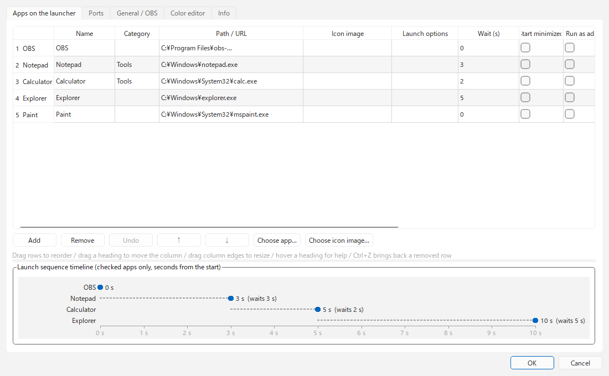
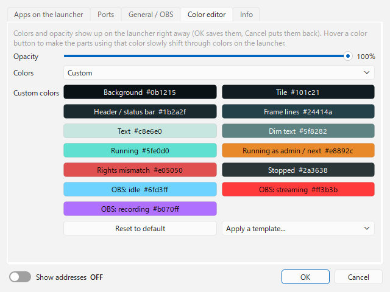

# DDLauncher

**English** | [日本語](README.ja.md) | [한국어](README.ko.md) | [Bahasa Indonesia](README.id.md) | [Français](README.fr.md) | [繁體中文](README.zh-TW.md)

A lightweight launcher for streamers that sits in a corner of the screen (Windows).

> [!TIP]
> **Drag & drop files into OBS as sources, even when OBS runs as administrator.**
> Normally, running OBS as administrator makes Windows block drag & drop from Explorer. DDLauncher takes the files you drop on the launcher and hands them to OBS over obs-websocket, so this restriction doesn't apply.

- Starts OBS and your other apps in a set order, with a delay between each. Apps that are already running aren't started twice.
- A colored lamp shows whether each app is running, and whether it runs as administrator.
- Normally shows just one small icon in the corner, and opens only when you hover over it.

<p>


</p>


## Requirements

- Windows 10 / 11
- OBS Studio 28 or later (the versions with obs-websocket 5 built in)
- UI languages: English / 日本語 / 한국어 / Bahasa Indonesia / Français / 繁體中文

## Download and install

Download one of these from [Releases](https://github.com/ChromeBread/DDLauncher/releases/latest).

| Version | File | Good for |
|---|---|---|
| Installer | `DDLauncher-0.2.1-windows-x64-setup.exe` | A Start menu entry, and removal from Windows "Apps" |
| Standalone | `DDLauncher-0.2.1-windows-x64-portable.zip` | No installation. Delete the folder to remove it |

- Standalone: unzip it anywhere and run `DDLauncher.exe`.
- The exe isn't signed, so on first launch Windows SmartScreen ("Windows protected your PC") or your antivirus may warn you. Click "More info" → "Run anyway". If you'd rather check first, run it from source (see "For developers" below).
- Both versions keep their settings in `%APPDATA%\CBApps\DDLauncher\`.

## Setting up OBS

1. In OBS, open "Tools" → "WebSocket Server Settings" and turn on "Enable WebSocket server".
2. Note the port and the password, and enter them in the launcher under ⚙ → "General / OBS".

## How to use

### Basics

- **Left-click an icon**: launches the app (does nothing if it's already running). **Right-click**: choose to launch with or without administrator rights.
- **Lock while OBS runs** (per app, on by default): while OBS is running, clicking an icon doesn't open the app or page, so a stray click can't show up on stream. The icon's right-click menu still opens it. Turn it off per app in ⚙ → "Apps on the launcher".
- **Right-click an empty area of the launcher**: menu with position (4 corners), launch sequence, D&D mode, always expanded, always on top (launcher / D&D space, each on its own), settings and quit.
- **Header buttons**: `▲▼` rotate the order / `D&D` toggle D&D mode / `▶` start or stop the sequence (if enabled in the settings) / `⚙` settings / `?` help
- **Tray icon**: click to show the launcher. Right-click to start the sequence or quit.
- **Settings / help windows**: open where they don't cover the launcher (whichever free space above, below, left or right fits).

### Display

- **Normal display** (⚙ → "General", or "Always expanded" in the right-click menu)
  - **Icon only** (default): only the `DD` icon sits in the corner. Hover over it (or click it) to open the whole launcher; it shrinks back to the icon 0.8 seconds after the mouse leaves.
  - **Always expanded**: stays open regardless of the mouse.
  - In D&D mode and during the launch sequence, it stays open either way (to show the drop target and the countdown).
- **Layout** (⚙ → "General")
  - **LINEAR**: not available yet (still being tuned).
  - **GROUP**: a column going up (or down) from the corner. With "GROUP: max down" set, the rest start a new column further in; "GROUP: max across" caps the number of columns (the columns grow taller instead). 0 = unlimited (a single column).
  - In both layouts, the mouse wheel (or ▲▼) rotates the order like a ring. Turn on "Rotated order" to keep the rotated order.
- **Category**: apps in the same category stack into one slot, and the rest slide out sideways toward the inside of the screen on mouse-over (e.g. register YouTube → Twitch → Kick in a "Platforms" category). Shift+wheel (or tilting the wheel) on the stacked tile, or the ◀▶ buttons on the slid-out row, change which app is in front.
- **Size**: **Ctrl+mouse wheel** on the launcher, or "Size" under ⚙ → "General", sets it between 50 and 250%. If it would no longer fit on the screen, it shrinks automatically.
- **Collapsed icon**: by default the `DD` icon. Under ⚙ → "General" you can show the icon of one of your registered apps or web pages instead.
- **Wheel rotation**: turn it off under ⚙ → "General" if the wheel moves the icons when you don't want it to. ▲▼ and Ctrl+wheel still work.
- **Language**: choose under ⚙ → "Info" → "Language". The default "Auto" follows OBS's UI language (or Windows' if OBS's settings can't be found). Unsupported languages fall back to English.

### Launch sequence

- Starts apps in the order set in the settings, each one "delay seconds after the previous app was started". The tile of the next app blinks orange, with `NEXT ▸ name seconds` shown below.
- Put DAWs and VB-Audio tools last with a longer delay so they don't fight over audio devices.
- **After the sequence**: "Do nothing / Minimize to taskbar / Hide". This runs only once every app is confirmed running (it waits up to 60 seconds). If anything failed or didn't start, the launcher stays visible.
- **▶ button**: hidden by default. Show it with ⚙ → "Sequence button". Even when hidden, you can start the sequence from the right-click menu or the tray.
- **Startup**: turn on ⚙ → "Startup" to start the launcher when you sign in to Windows and run the sequence right away.

### D&D mode

- Drop image, video or audio files on the D&D space (or the launcher) to add them as sources to the chosen OBS scene (the current program scene if left empty). Dropping on the launcher can be turned off with ⚙ → "Drop on launcher". If you drop many files at once (5 or more by default), it asks before adding them; change the number with ⚙ → "Confirm multiple drops". Turn on ⚙ → "Folders / mixed files" to drop whole folders and choose which kinds (images, videos, audio) to add, and to set the file extensions for each kind. ⚙ → "Sources added by D&D" sets how new sources start: shown or hidden, playing or stopped (or only the first file playing), volume, mute, loop, audio monitoring, fit to screen, and the source name.
  - "Fit to screen" and **Image Resize Reader for OBS**: if you use Image Resize Reader, leave "Fit to screen" off. It also fits sources added by DDLauncher, and with both on the source ends up shifted or cut off.
- In D&D mode, the launcher ignores the margin and snaps to the screen edge, so a file can't fall into the gap and land in another window. Turn this off with ⚙ → "Position in D&D mode".
- The D&D space opens right next to the launcher, touching it but never covering it. Drag a striped corner to change its size, or drag anywhere else to move it (⚙ → "D&D space resizing" lets you resize from the edges too). Size and position are remembered; if you drop it onto the launcher it slides to the nearest edge of the launcher. Right-click it to reset the size or put it back next to the launcher. If you lose track of it, use "Put the D&D space back next to the launcher (default size)" in ⚙.

### Reading the display

- **Top right of a tile**: `ADMIN` = running as administrator, `USER` = running with normal rights, `STANDBY` = stopped, `NO PATH` = no path set
- **Lamp colors**: gray = stopped, green = running (normal rights), orange = running (administrator), red = set to run as admin but running with normal rights
- **OBS tile frame**: light blue = not streaming, red = streaming, purple = recording only. While streaming / recording, the amount of data sent is shown at the bottom right of the icon. You can see the status even with the OBS window closed.

### Settings

- **Apps on the launcher**: drag rows (or use ↑↓) to reorder. Hover a column heading for an explanation.
  - If "Icon image" is empty, the exe's icon is used, or the site's icon when the path is a URL. Put a web address in "Icon image" to use that site's icon (or the image itself, for an image's address).
  - A removed row comes back with "Undo" (Ctrl+Z). The timeline under the table shows how many seconds after the start each app launches.
  - "Move to monitor" moves the app's window to that monitor after it starts. Apps started as administrator can't be moved because of a Windows restriction.
- **Ports**: register the ports you use to see whether each is free, in use, or in conflict (used by an unexpected process, or registered twice). "Free up" closes the process using that port (after a confirmation). "Detect" adds the ports your registered apps use (OBS from its WebSocket settings, other apps while they are running). Some comment viewers and text-to-speech tools popular with streamers are read from their settings files, so they are found even when closed. You choose which of the found ports to add, and it warns you if two linked apps disagree on a port. You can also note whether this PC's IP address is static or dynamic; "Check" fills it in by looking only at whether the wired / Wi-Fi connection uses DHCP. DDLauncher never reads the IP address itself, and a DHCP reservation on your router still shows as dynamic.
- **Color editor**: opacity, colors (default / custom) and six templates. Changes show on the launcher right away, and Cancel puts them back.
- **Info**: language, version, build date, developer credit and the Debug Mode switch.
  - **Debug Mode**: settings export / import, and more.

## Uninstalling

- **Installer version**: uninstall DDLauncher from Windows Settings → Apps. It first asks whether to use the safe uninstaller to export or remove your settings.
- **Standalone version**: to remove the settings too, run `DDLauncher-Uninstall.exe` first, then delete the folder.
- **Safe uninstaller** (`DDLauncher-Uninstall.exe`): export your settings first, review what it found (the settings folder, `DDLauncher*.exe` files including older versions, and the Windows startup entry), and move only the checked items to the Recycle Bin. Files unrelated to DDLauncher are never listed. The shared `%APPDATA%\CBApps\` folder is removed only when it is empty.

## Notes

- Settings are saved in `%APPDATA%\CBApps\DDLauncher\`. If settings exist in the old location `%APPDATA%\DDLauncher\`, they're copied over automatically on first start. The old folder is left as is, so an older version still works with it (changes made after the copy don't carry back to the older version).
- Apps set to run as admin show a UAC prompt every time they start (at Windows startup too).
- Some apps ignore "Start minimized". For OBS, putting `--minimize-to-tray` in "Launch options" is more reliable.
- The in-app help (`?`) covers the pros and cons of running as administrator, why drag & drop stops working, and how to fix black screens.

## License

GPL-3.0 ([LICENSE](LICENSE)). Licenses of the bundled libraries (PySide6 / Qt, obsws-python and others) are in [THIRD-PARTY-LICENSES.txt](THIRD-PARTY-LICENSES.txt).

## For developers

### Running from source

```powershell
py -m venv .venv
.venv\Scripts\pip install -r requirements.txt
.venv\Scripts\pythonw main.py
```

To build the folder version (`dist\DDLauncher\`) and the installer (the installer needs Inno Setup 6):

```powershell
.venv\Scripts\pip install pyinstaller
.venv\Scripts\pyinstaller DDLauncher.spec
iscc /DAppVersion=0.2.1 installer\DDLauncher.iss
```

### Files

| File | Role |
|---|---|
| `main.py` | Entry point. Holds the settings and creates / recreates the launcher windows. Checks app status every 2 seconds in one pass. |
| `launcher_window.py` | One launcher's window (corner placement, tiles, collapse / expand, D&D mode, menus) |
| `sequencer.py` | Launch sequence (order, delays, no double starts) |
| `winproc.py` | Windows-specific code (normal / admin launch, detecting elevated processes, startup registration, ports) |
| `obs_bridge.py` | Adding sources and reading stream status over obs-websocket 5 (runs on a separate thread so the UI never freezes) |
| `config.py` | Reading / writing settings (filling defaults, crash-safe saving, migrating from the old location) |
| `i18n.py` / `locales/` | UI language. UI text in `locales/<lang>.json`, help in `locales/help/<lang>.html` |
| `about.py` | Build date (written into the exe by `DDLauncher.spec`) and each language's date format |
| `theme.py` / `settings_dialog.py` | Look and feel, settings window |
| `uninstaller.py` | Safe uninstaller (`DDLauncher-Uninstall.exe`) |
| `startup_items.py` | Reading and changing Windows startup entries (registry Run and the Startup folder; backup before changes) |

- **Privilege split**: the launcher itself runs with normal rights. It receives drops from Explorer and passes the file paths to OBS (running as administrator) over the localhost WebSocket. WebSocket traffic isn't restricted by UIPI, so it gets through despite the different rights.
- **Multiple launchers**: `launchers` in the settings file is an array. Each element creates one window (this can't be added from the settings window yet, so edit the JSON directly).

Tests:

```powershell
.venv\Scripts\python tests\test_core.py
```
