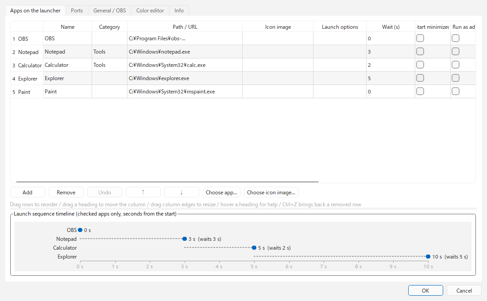
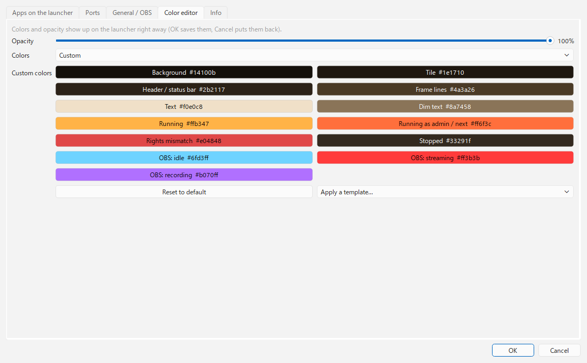

# DDLauncher

[English](README.md) | [日本語](README.ja.md) | [한국어](README.ko.md) | [Bahasa Indonesia](README.id.md) | [Français](README.fr.md) | **繁體中文**

給實況主使用的輕量常駐啟動器（Windows）。可以小小地放在畫面角落。

- 依照設定的順序，間隔一段時間自動啟動 OBS 等應用程式。已在執行中的應用程式不會重複啟動。
- 用指示燈的顏色顯示各應用程式是否執行中、是否以系統管理員權限執行。
- **即使 OBS 以系統管理員權限執行，也能拖放檔案來新增來源**（透過 obs-websocket）。
- 平常只在角落放一個小圖示，滑鼠移上去時才展開。

<p>


</p>


## 執行環境

- Windows 10 / 11
- OBS Studio 28 以上（內建 obs-websocket 5 的版本）
- 顯示語言：English / 日本語 / 한국어 / Bahasa Indonesia / Français / 繁體中文

## 下載與安裝

從 [Releases](https://github.com/ChromeBread/DDLauncher/releases/latest) 下載其中一個。

| 版本 | 檔案 | 適合 |
|---|---|---|
| 安裝版 | `DDLauncher-0.1.0-windows-x64-setup.exe` | 想登錄到開始功能表，並從 Windows「應用程式」移除 |
| 免安裝版 | `DDLauncher-0.1.0-windows-x64-portable.zip` | 不想安裝。整個資料夾刪掉即可移除 |

- 免安裝版：把 zip 解壓縮到任意位置，執行 `DDLauncher.exe`。
- 因為 exe 沒有簽章，第一次啟動時 Windows SmartScreen（「Windows 已保護您的電腦」）或防毒軟體可能會警告。點「其他資訊」→「仍要執行」即可啟動。若想先確認內容，請依下方「從原始碼執行」使用。
- 兩個版本的設定都存放在 `%APPDATA%\CBApps\DDLauncher\`。

### 從原始碼執行

```powershell
py -m venv .venv
.venv\Scripts\pip install -r requirements.txt
.venv\Scripts\pythonw main.py
```

製作資料夾版（`dist\DDLauncher\`）與安裝程式時（安裝程式需要 Inno Setup 6）：

```powershell
.venv\Scripts\pip install pyinstaller
.venv\Scripts\pyinstaller DDLauncher.spec
iscc /DAppVersion=0.1.0 installer\DDLauncher.iss
```

### OBS 端的準備

1. 在 OBS 的「工具」→「WebSocket 伺服器設定」中，開啟「啟用 WebSocket 伺服器」。
2. 記下連接埠（預設 4455）與密碼，填入啟動器的 ⚙ →「一般 / OBS」。

## 使用方式

### 基本操作

- **左鍵點圖示**：啟動應用程式（已在執行中則不動作）。**右鍵**：選擇以系統管理員或一般權限啟動。
- **OBS 執行中不開啟**（每個應用程式各自設定，預設開啟）：OBS 執行期間，點擊圖示不會開啟應用程式或網頁（防止直播中誤按）。仍可從圖示的右鍵選單開啟。可在 ⚙ →「啟動器上的應用程式」逐一關閉。
- **在啟動器空白處按右鍵**：開啟選單，可設定位置（四個角落）、啟動序列、D&D 模式、永遠展開、最上層顯示（啟動器／D&D 區域各自設定）、設定、結束。
- **標題列按鈕**：`▲▼` 轉動順序／`D&D` 切換模式／`▶` 開始・停止序列（在設定中顯示時）／`⚙` 設定／`?` 說明
- **系統匣圖示**：點一下顯示啟動器。按右鍵可開始序列或結束。
- **設定／說明視窗**：在不會擋住啟動器的位置（上・下・左・右的空位）開啟。

### 顯示

- **平常的顯示**（⚙ →「一般」，或空白處右鍵選單的「永遠展開」）
  - **只顯示圖示**（預設）：平常只在角落放一個 `DD` 圖示。滑鼠移上去（或點一下）就會整個展開，滑鼠離開 0.8 秒後變回圖示。
  - **永遠展開**：不論滑鼠位置，都保持展開。
  - D&D 模式中與啟動序列執行中，不論哪種設定都會保持展開（為了顯示拖放位置與剩餘秒數）。
- **顯示模式**（⚙ →「一般」）
  - **LINEAR**：尚未實作（調整中）。
  - **GROUP**：從角落直向排列。設定「GROUP：縱向上限」後，超過的部分會往內側再排一列；「GROUP：橫向上限」可限制列數（此時改為把每列拉長）。0 = 無限制（單一直列）。
  - 兩種模式都可以用滑鼠滾輪（或 ▲▼）像圓環一樣轉動順序。開啟「轉動後的順序」即可儲存。
- **分類**：相同分類的應用程式會疊在同一格，滑鼠移上去時其餘的會往畫面內側橫向展開（例：在分類「平台」中依序登錄 YouTube → Twitch → Kick）。在疊起來的圖塊上用 Shift+滾輪（或傾斜滾輪），或用展開那一列的 ◀▶，可以切換顯示在前面的應用程式。
- **大小**：在啟動器上用 **Ctrl+滑鼠滾輪**，或 ⚙ →「一般」的「大小」，可在 50～250% 之間調整。大到超出畫面時會自動縮小。
- **收合時的圖示**：預設為 `DD` 圖示。可在 ⚙ →「一般」改成已登錄的應用程式或網頁的圖示。
- **用滾輪轉動**：不希望滾輪移動圖示時，可在 ⚙ →「一般」關閉。▲▼ 與 Ctrl+滾輪仍可使用。
- **顯示語言**：在 ⚙ →「資訊」的「Language」選擇。預設的「自動」會配合 OBS 的顯示語言（找不到 OBS 設定時使用 Windows 的語言）。不支援的語言會以 English 顯示。

### 啟動序列

- 依設定畫面的順序，在「上一個應用程式啟動後 等待秒數 後」啟動下一個。下一個要啟動的應用程式圖塊會閃爍橘色，下方顯示 `NEXT ▸ 名稱 剩餘秒數`。
- DAW 或 VB-Audio 類放在最後並把等待時間拉長，比較能避免搶奪音訊裝置。
- **序列完成後**：可選「不執行任何動作／最小化到工作列／隱藏」。確認所有應用程式都已啟動後才執行（最多等待 60 秒），若有失敗或未啟動則保持顯示。
- **▶ 按鈕**：預設隱藏。可用 ⚙ →「序列按鈕」顯示。即使隱藏，也能從右鍵選單和系統匣開始序列。
- **開機啟動**：開啟 ⚙ →「開機啟動」後，登入 Windows 時會啟動啟動器並直接執行序列。

### D&D 模式

- 把圖片、影片、音訊檔案拖放到啟動器上，就會新增為 OBS 指定場景（留空則為目前的節目場景）的來源。
- D&D 模式中會忽略邊距，貼齊畫面邊緣（避免檔案掉進空隙而拖放到別的視窗）。可用 ⚙ →「D&D 時的位置」關閉。
- D&D 區域會緊貼在啟動器旁邊出現，但不會蓋住啟動器。拖曳離啟動器較遠那個角的斜線可調整大小，拖曳其他地方可移動位置。大小與位置會被記住；移到會蓋住啟動器的地方時，會移到緊貼啟動器最近一邊的位置。按右鍵可以恢復原本大小或放回啟動器旁邊。

### 畫面的看法

- **圖塊右上**：`ADMIN` = 以系統管理員權限執行中、`USER` = 以一般權限執行中、`STANDBY` = 已停止、`NO PATH` = 未設定路徑
- **指示燈顏色**：灰 = 已停止、綠 = 執行中（一般權限）、橘 = 執行中（系統管理員權限）、紅 = 設定為系統管理員卻以一般權限執行中
- **OBS 圖塊的外框**：淺藍 = 未直播、紅 = 直播中、紫 = 僅錄影。直播中／錄影中會在圖示右下顯示已傳送的資料量。即使關閉 OBS 視窗也能知道狀態。

### 設定畫面

- **啟動器上的應用程式**：拖曳列（或用 ↑↓）重新排序。滑鼠移到欄標題上可看各欄說明。
  - 「圖示圖片」留空時使用 exe 的圖示，路徑為 URL 時使用網站圖示。在圖示圖片填入網址，會使用該網站的圖示（若是圖片網址則使用該圖片）。
  - 刪除的列可用「復原」（Ctrl+Z）還原。表格下方的時間軸會顯示各應用程式在開始後幾秒啟動。
  - 選擇「啟動後移至的螢幕」後，啟動後會把視窗移到該螢幕。以系統管理員權限啟動的應用程式因 Windows 的限制無法移動。
- **連接埠管理**：登錄使用的連接埠後，會顯示空閒／使用中／衝突（由非預期程序使用，或重複登錄）。「釋放」會結束正在使用該連接埠的程序（會先確認）。「自動取得」可以加入登錄的應用程式使用的連接埠（OBS 從 WebSocket 設定讀取，其他應用程式則在執行中時取得）。OneComme 與 BouyomiChan 也會從設定讀取，所以沒開啟也找得到；Yukarinette Connector NEO 則在執行中時取得。可以從找到的連接埠中選擇要新增的項目；若 OneComme 傳送的連接埠與 BouyomiChan 不一致，會提醒你。也可以備註這台電腦的 IP 位址是固定還是浮動。按「自動判定」只會確認有線／Wi-Fi 是否自動取得 IP 位址（DHCP）並填入，不會取得 IP 位址本身。路由器端的 DHCP 保留在自動判定中會顯示為「浮動」。
- **色彩編輯器**：可選擇不透明度、配色（預設 / 自訂）與 6 種範本。變更的顏色會立即反映在啟動器上，按取消即還原。
- **資訊**：顯示語言、版本、建置日期、開發者標示，以及 Debug Mode 的切換。

## 解除安裝

- **安裝版**：從 Windows「設定」→「應用程式」解除安裝 DDLauncher。一開始會詢問是否要使用安全解除安裝程式來匯出或刪除設定。
- **免安裝版**：若也要刪除設定，請先執行 `DDLauncher-Uninstall.exe`，再刪除整個資料夾。
- **安全解除安裝程式**（`DDLauncher-Uninstall.exe`）：可先匯出設定，在清單中確認找到的項目（設定資料夾、包含舊版的 `DDLauncher*.exe`、Windows 自動啟動的登錄）後，只把勾選的項目移到資源回收筒。與 DDLauncher 無關的檔案不會出現在清單中。共用的 `%APPDATA%\CBApps\` 資料夾只在變空時才整理。

## 注意事項

- 設定儲存在 `%APPDATA%\CBApps\DDLauncher\`。若舊的儲存位置 `%APPDATA%\DDLauncher\` 有設定，第一次啟動時會自動複製過來。舊資料夾會保留，所以退回舊版本也能使用設定（複製後的變更不會反映到舊版本）。
- 設定為系統管理員的應用程式，每次啟動都會出現 UAC 確認（開機啟動時也一樣）。
- 有些應用程式會忽略「最小化啟動」。OBS 在「啟動選項」填入 `--minimize-to-tray` 比較可靠。
- OBS 密碼以明文儲存在設定檔中。
- 以系統管理員權限執行的優缺點、無法拖放的原因、黑畫面的處理方法，都整理在應用程式內的說明（`?`）中。

## 授權

GPL-3.0（[LICENSE](LICENSE)）。隨附函式庫（PySide6 / Qt、obsws-python 等）的授權整理在 [THIRD-PARTY-LICENSES.txt](THIRD-PARTY-LICENSES.txt)。

## 開發者資訊

| 檔案 | 用途 |
|---|---|
| `main.py` | 進入點。保存設定並建立／重建啟動器視窗。每 2 秒一次確認所有應用程式的狀態。 |
| `launcher_window.py` | 一個啟動器的畫面（角落配置、圖塊、收合／展開、D&D 模式、選單） |
| `sequencer.py` | 啟動序列（順序・等待時間・防止重複啟動） |
| `winproc.py` | Windows 專用處理（一般／系統管理員啟動、判斷其他程序是否提升權限、開機啟動登錄、連接埠） |
| `obs_bridge.py` | 透過 obs-websocket 5 新增來源與取得直播狀態（在另一個執行緒執行，不會讓畫面卡住） |
| `config.py` | 讀寫設定（補上預設值、中途斷電也不會損壞的儲存方式、從舊位置移轉） |
| `i18n.py` / `locales/` | 顯示語言。畫面文字在 `locales/<語言>.json`，說明在 `locales/help/<語言>.html` |
| `about.py` | 建置日期（exe 由 `DDLauncher.spec` 寫入）與各語言的日期寫法 |
| `theme.py` / `settings_dialog.py` | 外觀、設定畫面 |
| `uninstaller.py` | 安全解除安裝程式（`DDLauncher-Uninstall.exe`） |

- **權限分離**：啟動器本身以一般權限執行。它接收來自檔案總管的拖放，再透過 localhost 的 WebSocket 把檔案路徑傳給以系統管理員權限執行的 OBS。WebSocket 連線不受 UIPI 限制，即使權限不同也能傳到。
- **多個啟動器**：設定檔中的 `launchers` 是陣列。每多一個元素就會多建立一個視窗（目前無法從設定畫面新增，請直接編輯 JSON）。

測試：

```powershell
.venv\Scripts\python tests\test_core.py
```
